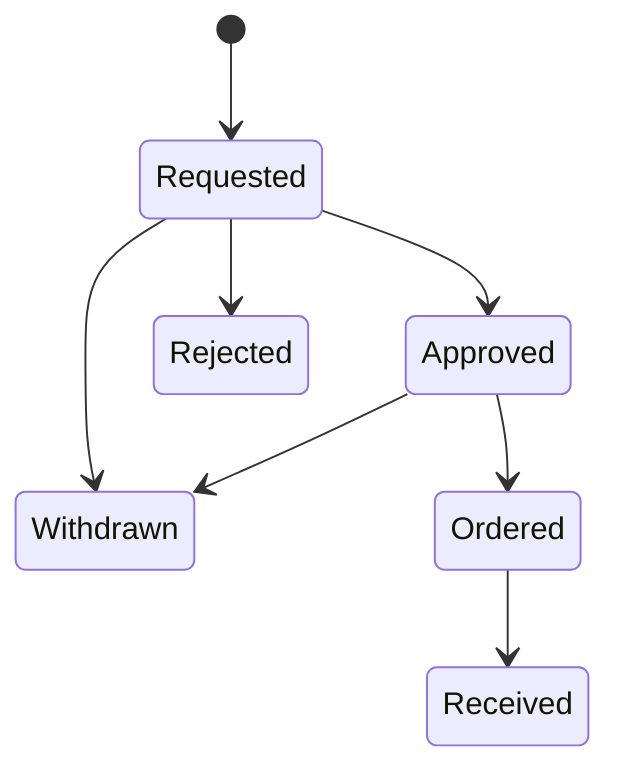
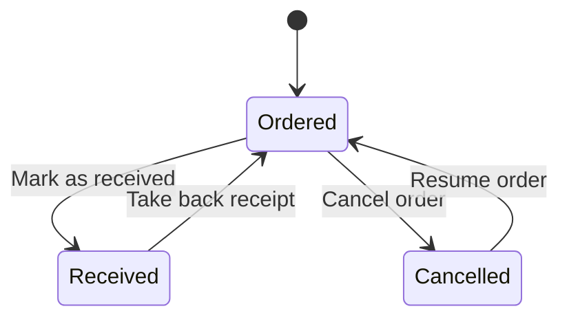

import { Aside, Badge, Steps } from '@astrojs/starlight/components';

Under **Inventory › Procurement** you take procurement requests from the request to the inventory: what is to be bought, for which department and location, at what price, and how the management decided. A request can be printed for signature, saved as a PDF or sent as a prepared e-mail. Once approved, you link it to the assets and consumables it brought.

What is ordered at once without a request, such as toner or cables, you record as an [order](#orders-without-a-request). On [receipt](#booking-a-receipt-into-stock), requests and orders book the delivered consumables straight into stock.

Procurement is part of the Community edition. Pro adds the [reorder proposal](#reorder-proposal) from the minimum stock and [creating devices as assets](#creating-devices-as-assets) on receipt. You assign cost centers to requests and orders as described under [Cost centers](/en/guides/kostenstellen/).

## Prerequisites

- A role that may write procurement requests: **Administrator**, **Information security** or **Editor**. All other roles only see the requests (see [Rights](#rights)).
- For the printed form with a letterhead: a [logo of the organisation](#logo-of-the-organisation-for-the-printed-form).
- For the signed copy: a configured storage for documents.

## Adding a request

<Steps>

1. Open **Inventory › Procurement** and choose **Add request**.

2. Under **Department and location**, enter the **Department**, the **Location**, **Requested by** and the **Date of request**. **Requested by** is filled in with your name.

3. Under **What it is about**, describe the **Subject**, such as “Equipment for cable labelling”, and the **Reason**: why the purchase is needed and what else counts for the decision.

4. Under **Positions**, add each position. **Add position** adds another, **Remove** takes one away. For each position:
   - **Item** and **Kind** (**Device or asset**, **Consumable**, **Service** or **Other**);
   - for the kind **Consumable**, optionally the item under **Consumable** (see [Positions with consumables](#positions-with-consumables));
   - **Article number** and **Item description**;
   - **Quantity** and **Unit price**.

   The page works out the **Total** per position and for the whole request as you type.

5. Under **Costs**, choose the **Supplier**, enter the **Offer** (its number or name) and set under **Price** whether the amounts are **gross** or **net**. This applies to all positions.

6. Choose **Add request**.

</Steps>

A request has 1 to 100 positions; the quantity per position is between 1 and 100,000, and the total is at most one billion euros. If a supplier is missing from the list, create it right there, provided you may create suppliers.

### Numbers

Each request gets a running number within your organisation, such as `BA-0001`. [Orders](#orders-without-a-request) are counted apart and carry the prefix `BE`, such as `BE-0001`; the prefix tells you whether an approval stands behind it. A number is never given twice, not even after deletion, because a signed paper or a booking in the consumables may name it.

The search finds requests and orders by subject, department and requester, and by the item and article number of their positions. The **Kind** filter shows **All**, only **Requests** or only **Orders**; the **Status** filter narrows the list further.

## Status and allowed changes

| Status | Meaning |
|---|---|
| **Requested** | The request awaits a decision. |
| **Approved** | The management agreed. |
| **Rejected** | The management refused; the reason shows at the request. |
| **Ordered** | The order has been placed. |
| **Taken into the inventory** | Delivered and taken into the inventory. |
| **Withdrawn** | The request is not pursued further. |

The steps are on the request's page under **Progress**: **Record approval**, **Record rejection**, **Withdraw request**, **Mark as ordered** and **Mark as received**. Approval, rejection, order and receipt carry their date. The server accepts no other changes.

Each status also allows exactly one step back, so a slip can be undone, such as **Take back approval**, **Take back order** or **Reopen** for a withdrawn request.

A request can be **deleted** only while nothing has been ordered: as **Requested**, **Rejected** or **Withdrawn**. The audit log keeps a record of it.

## Positions with consumables

A position of the kind **Consumable** can name the item it means, such as “Toner HP 26X”. Choose it in the dialog of the request or order under **Consumable**; **Not assigned** leaves the position without an item. You can choose from your organisation's items that you may see.

An assigned position is booked into the item's stock on [receipt](#booking-a-receipt-into-stock). Without an assignment it stays a plain line of the cost breakdown.

## Orders without a request

Consumables and small items are often ordered at once, without the management having to agree. For that there is the order next to the request. It has the same details as a request, but no approval.

<Steps>

1. Open **Inventory › Procurement** and choose **Add order**.

2. Under **Department and location**, enter the **Department**, the **Location**, **Ordered by** and **Ordered on**. The order counts as ordered from this date.

3. Fill in **What it is about**, **Positions** and **Costs** as for a [request](#adding-a-request). Assign positions of the kind **Consumable** to their item if the receipt is to book them in.

4. Choose **Add order**.

</Steps>

The order gets a number with the prefix `BE` and is listed next to the requests.

### Status of an order

| Status | Meaning |
|---|---|
| **Ordered** | The order has been placed; every order starts here. |
| **Taken into the inventory** | Delivered and taken into the inventory. |
| **Cancelled** | The order is no longer pursued. |

- **Cancel order** ends an order, **Resume order** brings it back to **Ordered**.
- **Mark as received** records the [receipt](#booking-a-receipt-into-stock); **Take back receipt** takes it back.
- Until the receipt you can change the content freely. Once the order is received or cancelled, positions, supplier, offer and price stay as they were; you can still change **Department**, **Location** and **Ordered by**.
- An order can be **deleted** only once it is cancelled. The audit log keeps a record of it.

### Print, PDF and e-mail

An order is printed, saved and sent like a request with **Print**, **As PDF** and **Send by e-mail** (see [As PDF and by e-mail](#as-pdf-and-by-e-mail)). The form is called **Order**, the file something like `Order-BE-0003.pdf`. It has no **Approval** box, and no signed copy can be attached to an order.

## Approval on paper

Many managers prefer to sign on paper. The printed form is made for that.

<Steps>

1. Open the request and choose **Print**. The form shows your organisation's logo in its header, the department and location, the description, the costs and an **Approval** box with yes or no, the reason, **Place, date** and **Signature of the management**.

2. Print the request, or choose “Save as PDF” in the print dialog, and hand it to the management.

3. Scan the signed copy and choose **Upload signed copy** under **Signed copy** at the request. The file is stored as a document of the kind **Evidence** and linked to the request; the document's page names the request as a use.

4. Record the decision as it stands on the paper: **Record approval** with the **Date of approval**, or **Record rejection** with the date and the **Reason for rejection**.

</Steps>

Once the decision is recorded, it is ticked on the printed form. **Replace copy** swaps the file, **Remove link** detaches it from the request. If the document is deleted, the request loses the link with an entry in the audit log.

## Approval in the app

If the management does not sign on paper, a person with write access records the decision directly with **Record approval** or **Record rejection**. A rejection always needs a reason; a reason is accepted only with a rejection.

<Aside type="caution" title="A record, not a permission check">
The status **Approved** records the management's decision. It is not a technical four-eyes approval: whoever may write requests can set it, even for their own request. What counts is the management's decision, such as the signature on paper. Every change of status is in the audit log with person and time.
</Aside>

## Changes to an approved request

The approval applies to the content the management saw.

- **Approved:** if you change the item, kind, quantity, description, supplier, offer, price or the positions, the request goes back to **Requested** and needs a new approval. The link to the signed copy is removed, because that copy approved the earlier content.
- **Ordered, Taken into the inventory, Rejected or Withdrawn:** content and price no longer change. You can still change **Department**, **Location** and **Requested by**.

If two people edit the same request at the same time, the server accepts only the first change; the second gets the message “The request was changed meanwhile. Please reload the page.”

## As PDF and by e-mail

Beside **Print**, the request's page offers further ways. The PDF is always built in the browser, laid out like the printed form with logo, positions and the **Approval** box.

- **As PDF** saves the request as a PDF file, for example `Procurement-request-BA-0001.pdf`.
- **Send by e-mail** sends the request with the PDF attached through your organisation's mail server. The button appears once the [mail server is set up](/en/guides/benachrichtigungen/) and domains are allowed for sending (or every domain is allowed), and only for roles that may change the request.
- **Open in mail program** opens your computer's mail program with subject, summary and link, but without the PDF. If none is set up there, such as with webmail, nothing happens; then **Copy mail text** copies subject and text for a new mail. It is there as long as sending through the mail server is not set up; a hint beside **Status** then says what is missing.

### Sending by e-mail

<Steps>

1. On the request's page, choose **Send by e-mail**.

2. Under **Recipients**, enter one to five addresses separated by commas. Only addresses in the domains the administration allowed are accepted; the dialog names them.

3. Add a **Message** if you like, at most 1,000 characters, and choose **Send**.

</Steps>

SentryAssets writes subject and text from the request: number, subject, requester, total and a link to the request, plus your message and your name. The sender stays the configured one. If your account has a confirmed e-mail address, replies go to it; otherwise to the sender address of the mail server, and the dialog points this out. Local accounts get their address from the administration under **Settings › Users**; when you sign in through the identity provider, it comes from there. Sending runs in the background; a notice tells you once the mail server has the mail, or why not. If the mail server accepts only some recipients, the notice says so.

The limits: at most 5 recipients per sending, 20 sendings per person and hour and 200 per organisation and day; addresses with `%` or `!` before the `@` are refused. The PDF is checked like an uploaded document, kept encrypted until it went out and deleted afterwards. The audit log names the number of recipients and their domains, never an address or the message.

## Linking to the inventory

From the approval on, the request shows the card **In the inventory**: what it brought. An order shows it from the start.

<Steps>

1. Choose **Add asset**. The dialog for a new asset starts with the item, location and supplier of the request; the new asset is linked to the request at once.

2. Or choose **Assign existing**, the **Kind** (**Asset** or **Consumable**), search by name and choose **Assign** at a match.

3. Once everything has arrived, choose **Mark as received** with the **Date of receipt**.

</Steps>

A request names at most 1,000 assets and items, each once. Linking does not change the asset. **Remove** detaches a link; if a linked asset or item is deleted, the link goes with an entry in the request's audit log.

### Creating devices as assets

<Badge text="Pro" variant="note" /> This section applies from the Pro edition.

When ten notebooks arrive, you create them as ten assets in one step. From **Approved** on, so also at **Ordered** and **Taken into the inventory**, the **In the inventory** card shows the section **Create devices as assets** with every position of the kind **Device or asset** and its state “… of … created”. Devices can thus be created on delivery, before the formal receipt.

<Steps>

1. At the position, choose **Create … assets**.

2. Choose the **Category**. None is proposed; choose it deliberately.

3. Check the **Location**. Proposed is the location of the order.

4. Check the **Name**. It is preset with the position's title; each asset gets a running number after it.

5. Enter **Manufacturer**, **Model** and the **Purchase date** if needed. The purchase date is preset with the order date, without one with the date of the request: warranty and depreciation count from the purchase, not from the delivery. It is kept where the category has a purchase date.

6. Choose the **Number** and tick **Enter … as reseller** if needed, so that the order's supplier is on the asset.

7. Under **Serial numbers**, scan or type the serial number of each piece. Enter moves on to the next piece and never submits, because a [hand scanner](/en/guides/scanner/) ends every code with Enter.

8. Choose **Create … assets**.

</Steps>

All assets are linked to the request or order and its position. The inventory number comes from the category's numbering, if it has one. Assets and links are created together or not at all.

- **Known serial number:** if an existing asset already carries a serial number you entered, SentryAssets refuses at first and marks the piece (“An existing asset has this serial number already.”). Usually the code was read twice or the device came back. If it really is a second device with the same number, tick **Take known serial numbers anyway** and create again. Upper and lower case do not matter in the comparison.
- **Twice in one step:** the same serial number on two pieces is refused.
- **Quantity:** at most 100 pieces per step and never more than the position's open pieces. A link made by hand does not count. If a created asset is deleted, its piece is open again.
- **Required fields:** if the category has required fields, SentryAssets refuses; create these assets one by one with **Add asset**.
- **No undo:** the message after creating offers no “Undo”, because deleting up to 100 assets again would be a mass deletion of its own. Delete a wrongly created asset in the asset list; its link goes with it.
- **Rights:** the right to change procurement and the inventory; with [rights per location](/en/pro/standortrechte/), write access at the order's location and at the assets' target location.

## Booking a receipt into stock

Once delivered, choose **Mark as received** on a request or an order. If it has positions with an [assigned consumable](#positions-with-consumables), the dialog shows a **Receipt** section below.

<Steps>

1. On a request or an order, choose **Mark as received** and enter the **Date of receipt**.

2. Under **Receipt**, check the tick **Book … in** for each position. Without the tick nothing is booked for that position.

3. Choose the **Storage location**. The location of the request or order is filled in.

4. Check the **Quantity**. The quantity ordered is filled in and shown below the field as **ordered: …**; more than ordered cannot be confirmed.

5. Choose **Mark as received** in the dialog.

</Steps>

The receipt and its bookings happen in one step: if a booking fails, the receipt is not recorded either. Each booking is a **Receipt** at the chosen storage location, dated with the date of receipt. The booked item is linked to the request or order and shows in the card **In the inventory**.

- **Quantity:** per position at most the quantity ordered in total; less works, for a partial delivery for instance.
- **Only once:** a request or an order books in only once.
- **Origin:** each booking names the request or order it came from. In the [consumables](/en/guides/verbrauchsmaterial/), the **Voucher** column under **Bookings** shows the number, such as `BE-0003`, with a link back. Only the server sets it.
- **Rights:** booking in needs the right to change consumables. Without it the dialog says “You may not change consumables, so nothing is booked in; the receipt is recorded without bookings.” With [rights per location](/en/pro/standortrechte/) (from Pro) you also need write access at the storage location.

### Scan the delivery

<Badge text="Pro" variant="note" /> This section applies from the Pro edition.

Instead of typing the quantities, you scan the packages delivered. The **Receipt** section of the dialog has a field **Scan the delivery** for this. An item is recognised by its [EAN](/en/guides/verbrauchsmaterial/#ean-of-an-item).

<Steps>

1. Choose **Mark as received** and put the cursor in the **Scan the delivery** field.

2. Scan every package delivered once. After each scan the count shows below the field, such as “Toner HP 26X: 3 of 5”.

3. Check the **Storage location** and **Quantity** of each position and choose **Mark as received** in the dialog.

</Steps>

How it counts:

- **Each package counts one** for the position with that item. If you order in boxes but count in pieces, adjust the quantity by hand afterwards.
- **From the first scan on, only what is scanned counts:** the first scan clears the tick **Book … in** of every position and sets the quantities to 0. Afterwards only the positions you scanned something of are booked in. A partial delivery thus books only what arrived.
- **At most what was ordered:** once a position is full, the field says “… all … counted already.” and counts no further. Book an excess delivery in the consumables as a separate **Receipt**.
- An item that is not part of the order is not counted (“… is not part of this order.”), nor is a code without an item (“There is no item for ….”). For a new code, first add the item with its EAN or use [receive by scan](/en/guides/verbrauchsmaterial/#receive-by-scan).

When booking in, the server checks rights and quantities as without scanning.

<Aside type="caution" title="A receipt taken back keeps its bookings">
**Take back receipt** only resets the status. The bookings stay, because bookings are never changed or deleted. A second receipt of the same order therefore books nothing. Correct a wrong booking in the consumables with a counter-booking, such as a **Withdrawal** or a **Stocktaking**.
</Aside>

## Reordering

**Reorder** opens a new order with the item already as its first position of the kind **Consumable**, with its article number and supplier. You find it in two places:

- on an item's page under **Inventory › Consumables**;
- on an asset's page in the **Consumables** card, at each assigned item (see [Assigning consumables to an asset](/en/guides/verbrauchsmaterial/#assigning-consumables-to-an-asset)).

The quantity is already what is missing up to the minimum stock. If the item is short at exactly one location (or kept at one only), that location is chosen for the order; if it is short at several, the quantity is the sum and you choose the location. Check the quantity, add the price and choose **Add order**. **Reorder** shows only if you may write procurement and the item is not archived.

## Reorder proposal

<Badge text="Pro" variant="note" /> This section applies from the Pro edition.

If you keep many consumables, you do not reorder item by item. **Inventory › Reorder proposal** lists every active item that is below its minimum at one location at least, grouped by supplier; items without a supplier come last under **Without supplier**. You also reach the page from [Consumables](/en/guides/verbrauchsmaterial/) with the filter **Below minimum** through **Reorder proposal for … items**.

For each item the proposal shows:

- **Shortfall:** per location what is missing up to the minimum (“…: … of …”), and the sum;
- **On order:** what is already on its way in requests and orders with the status **Requested**, **Approved** or **Ordered**;
- **Order quantity:** the shortfall less what is on order, never below zero. If everything is on its way, it reads **Already on its way**.

<Steps>

1. Open **Inventory › Reorder proposal**.

2. In a group, choose the items you want to order and adjust the **Order quantity** if needed.

3. Choose **Create order** at the group.

4. In the dialog, check **Title** (preset “Reorder of consumables”), **Ordered by**, **Ordered on** and the **Location of the order**. Suggested is the location where all chosen items are short.

5. Choose **Create order**.

</Steps>

This creates an [order](#orders-without-a-request) with the group's supplier, one position of the kind **Consumable** per item with article number and quantity, without a price. Add the prices in the order if needed. **Undo** in the message cancels and deletes the order again; afterwards, use **Cancel order** in procurement.

- **Rights:** reading needs the right to read consumables and procurement; creating needs the right to change procurement and, with [rights per location](/en/pro/standortrechte/), write access at the order's location.
- **Limits:** at most 100 positions per order and at most 2,000 items in the proposal. The audit log records the creation as for any order.

## The “Procurement” card on the overview

The **Overview** shows a **Procurement** card with the requests not yet decided. In addition, every request whose status changed (approved, rejected, ordered, received, withdrawn) stays there for three days and then disappears by itself. The card shows at most eight requests, the most recently changed first, and leads to the full list with **To procurement**.

What counts is the last change of status, not the last edit: a change to the department or location does not bring a decided request back onto the card.

## Rights

| Role | Procurement requests and orders |
|---|---|
| Administrator, Information security, Editor | view, add, change, record progress, delete, link, reorder, send by e-mail |
| Data protection, Auditor, Read only | view, print, save as PDF |

The signed copy shows only to people whose confidentiality level allows the document; others see the note “A document above your confidentiality level”. With [rights per location](/en/pro/standortrechte/) (from Pro), a request with a location needs write access at that location, a move at both; a person bound to locations writes no request without a location.

The audit log records adding, changing, status changes and deleting with number, status and the names of changed fields, plus the number of positions, total quantity and total price. Free text such as item, description, requester, offer and reason for rejection appears there only as “changed”, because it may name people.

## Logo of the organisation for the printed form

The logo appears in the header of the printed form, in the PDF and in the handover protocol of asset handovers.

<Steps>

1. Open **Settings › Organisation**. Only the administration sets the logo.

2. Under **Logo**, choose **Upload logo** and a file.

3. Check the preview. **Replace logo** swaps it, **Remove logo** deletes it.

</Steps>

Allowed are **PNG** and **JPEG** of at most **512 KB** and **4096 × 4096 pixels**; landscape with a transparent or white background works best. The format is recognised by the file's content, not by its name or extension. SVG and other formats are refused for security reasons, because they can carry executable content. The server does not convert the image. Every change is in the audit log with type, size and dimensions.

## Check the result

- The request is listed under **Inventory › Procurement** with its number, **Department / location** and **Status**.
- After **Record approval**, the page shows **Approved on** and the card **In the inventory**.
- The **Procurement** card on the overview shows open requests and recent decisions.
- An order is listed with the prefix `BE` and the status **Ordered**; the **Kind** filter › **Orders** shows only orders.
- After the receipt, the item shows the new stock under **Stock per location** and a **Receipt** under **Bookings** with the number in the **Voucher** column.

## Troubleshooting

- **“This step is not possible from the current status.”** The change is not part of the flow, such as from **Requested** straight to **Ordered**. Record the approval first.
- **“An ordered request cannot be deleted.”** Withdraw it instead, or take back the order. Cancel an order first with **Cancel order**; then it can be deleted.
- **“Linking is possible once the request is approved.”** Assets and consumables can be assigned only to an approved request.
- **“This receipt was booked already. Correct a wrong booking in the consumables with a counter-booking.”** The receipt was taken back and recorded again; the first bookings still stand. Record the receipt without the tick **Book … in** and correct the stock in the consumables.
- **“No more than was ordered can be booked in.”** The **Quantity** of a position is above the quantity ordered. Book in at most what was ordered; book an over-delivery in the consumables as a separate **Receipt**.
- **“This position is no consumable.”** Only positions of the kind **Consumable** that are assigned to an item are booked in. Reload the page if the positions changed meanwhile.
- **“The consumable is archived and takes nothing in.”** A position's item is archived. Choose **Use again** on the item, or leave out the tick for this position.
- **“An order needs no signed approval.”** No signed copy can be attached to an order. If the purchase needs an approval, add a request.
- **“Please choose a storage location”:** every position ticked **Book … in** needs a **Storage location**.
- **Characters show as “?” in the PDF:** the PDF uses the standard fonts, which know Western European characters. It replaces others with “?”; the file stays readable. The printed form from **Print** shows all characters.
- **"An address is not in an allowed domain."** Sending works only to domains allowed under **Settings › E-mail**, subdomains not included. Ask the administration to add the domain.
- **No "Send by e-mail", only "Open in mail program":** the mail server or the allowed domains are missing; the hint beside **Status** names what.
- **“The code could not be looked up just now. Please scan it again.”** The connection to the server was briefly interrupted. Scan the package again; it was not counted.
- **“An existing asset has this serial number already.”** Check whether the code was read twice. If it really is another device, tick **Take known serial numbers anyway**.
- **“The category has required fields. Create these assets one by one.”** Use **Add asset** for each piece.
- **“That many pieces are no longer open. Reload the page.”** Pieces were created meanwhile, or the position changed.
- **“The order could not be created. Reload the proposal and try again.”** Stock or open quantities changed; the reloaded proposal shows the current state.
- **The logo is refused:** check format, size and dimensions. The server does not accept a damaged or truncated file.
