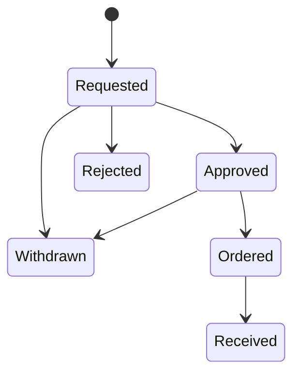

import { Aside, Steps } from '@astrojs/starlight/components';

Under **Inventory › Procurement** you take procurement requests from the request to the inventory: what is to be bought, for which department and location, at what price, and how the management decided. A request can be printed for signature, saved as a PDF or sent as a prepared e-mail. Once approved, you link it to the assets and consumables it brought.

Procurement is part of the Community edition.

## Prerequisites

- A role that may write procurement requests: **Administrator**, **Information security** or **Editor**. All other roles only see the requests (see [Rights](#rights)).
- For the printed form with a letterhead: a [logo of the organisation](#logo-of-the-organisation-for-the-printed-form).
- For the signed copy: a configured storage for documents.

## Adding a request

<Steps>

1. Open **Inventory › Procurement** and choose **Add request**.

2. Under **Department and location**, enter the **Department**, the **Location**, **Requested by** and the **Date of request**. **Requested by** is filled in with your name.

3. Under **What it is about**, describe the **Subject**, such as “Equipment for cable labelling”, and the **Reason**: why the purchase is needed and what else counts for the decision.

4. Under **Positions**, add each position. **Add position** adds another, **Remove** takes one away. For each position:
   - **Item** and **Kind** (**Device or asset**, **Consumable**, **Service** or **Other**);
   - **Article number** and **Item description**;
   - **Quantity** and **Unit price**.

   The page works out the **Total** per position and for the whole request as you type.

5. Under **Costs**, choose the **Supplier**, enter the **Offer** (its number or name) and set under **Price** whether the amounts are **gross** or **net**. This applies to all positions.

6. Choose **Add request**.

</Steps>

A request has 1 to 100 positions; the quantity per position is between 1 and 100,000, and the total is at most one billion euros. If a supplier is missing from the list, create it right there, provided you may create suppliers.

### Numbers

Each request gets a running number within your organisation. A number is never given twice, not even after a request is deleted, because a signed paper may name it. The search finds requests by subject, department and requester, and by the item and article number of their positions; the **Status** filter narrows the list.

## Status and allowed changes

| Status | Meaning |
|---|---|
| **Requested** | The request awaits a decision. |
| **Approved** | The management agreed. |
| **Rejected** | The management refused; the reason shows at the request. |
| **Ordered** | The order has been placed. |
| **Taken into the inventory** | Delivered and taken into the inventory. |
| **Withdrawn** | The request is not pursued further. |

The steps are on the request's page under **Progress**: **Record approval**, **Record rejection**, **Withdraw request**, **Mark as ordered** and **Mark as received**. Approval, rejection, order and receipt carry their date. The server accepts no other changes.

Each status also allows exactly one step back, so a slip can be undone, such as **Take back approval**, **Take back order** or **Reopen** for a withdrawn request.

A request can be **deleted** only while nothing has been ordered: as **Requested**, **Rejected** or **Withdrawn**. The audit log keeps a record of it.

## Approval on paper

Many managers prefer to sign on paper. The printed form is made for that.

<Steps>

1. Open the request and choose **Print**. The form shows your organisation's logo in its header, the department and location, the description, the costs and an **Approval** box with yes or no, the reason, **Place, date** and **Signature of the management**.

2. Print the request, or choose “Save as PDF” in the print dialog, and hand it to the management.

3. Scan the signed copy and choose **Upload signed copy** under **Signed copy** at the request. The file is stored as a document of the kind **Evidence** and linked to the request; the document's page names the request as a use.

4. Record the decision as it stands on the paper: **Record approval** with the **Date of approval**, or **Record rejection** with the date and the **Reason for rejection**.

</Steps>

Once the decision is recorded, it is ticked on the printed form. **Replace copy** swaps the file, **Remove link** detaches it from the request. If the document is deleted, the request loses the link with an entry in the audit log.

## Approval in the app

If the management does not sign on paper, a person with write access records the decision directly with **Record approval** or **Record rejection**. A rejection always needs a reason; a reason is accepted only with a rejection.

<Aside type="caution" title="A record, not a permission check">
The status **Approved** records the management's decision. It is not a technical four-eyes approval: whoever may write requests can set it, even for their own request. What counts is the management's decision, such as the signature on paper. Every change of status is in the audit log with person and time.
</Aside>

## Changes to an approved request

The approval applies to the content the management saw.

- **Approved:** if you change the item, kind, quantity, description, supplier, offer, price or the positions, the request goes back to **Requested** and needs a new approval. The link to the signed copy is removed, because that copy approved the earlier content.
- **Ordered, Taken into the inventory, Rejected or Withdrawn:** content and price no longer change. You can still change **Department**, **Location** and **Requested by**.

If two people edit the same request at the same time, the server accepts only the first change; the second gets the message “The request was changed meanwhile. Please reload the page.”

## As PDF and by e-mail

Next to **Print**, the request's page offers two more ways. Both make the PDF in the browser, laid out like the printed form with logo, positions and **Approval** box. The data do not leave your device for this, and the server sends nothing.

- **As PDF** saves the request as a PDF file, such as `Beschaffungsantrag-<number>.pdf`.
- **Send by e-mail** saves a mail file (`.eml`) with subject, summary, a link to the request and the PDF attached. The file is marked as unsent: when you open it, Outlook shows it as a draft and you only add the recipient.
- **without attachment** opens your mail program with subject, summary and link, but without the PDF. Use it with mail programs that do not open mail files as drafts, and attach the PDF yourself.

## Linking to the inventory

From the approval on, the request shows the card **In the inventory**: what it brought.

<Steps>

1. Choose **Add asset**. The dialog for a new asset starts with the item, location and supplier of the request; the new asset is linked to the request at once.

2. Or choose **Assign existing**, the **Kind** (**Asset** or **Consumable**), search by name and choose **Assign** at a match.

3. Once everything has arrived, choose **Mark as received** with the **Date of receipt**.

</Steps>

A request names at most 1,000 assets and items, each once. Linking does not change the asset. **Remove** detaches a link; if a linked asset or item is deleted, the link goes with an entry in the request's audit log.

## The “Procurement” card on the overview

The **Overview** shows a **Procurement** card with the requests not yet decided. In addition, every request whose status changed (approved, rejected, ordered, received, withdrawn) stays there for three days and then disappears by itself. The card shows at most eight requests, the most recently changed first, and leads to the full list with **To procurement**.

What counts is the last change of status, not the last edit: a change to the department or location does not bring a decided request back onto the card.

## Rights

| Role | Procurement requests |
|---|---|
| Administrator, Information security, Editor | view, add, change, record progress, delete, link |
| Data protection, Auditor, Read only | view, print, save as PDF or mail file |

The signed copy shows only to people whose confidentiality level allows the document; others see the note “A document above your confidentiality level”. With [rights per location](/en/pro/standortrechte/) (from Pro), a request with a location needs write access at that location, a move at both; a person bound to locations writes no request without a location.

The audit log records adding, changing, status changes and deleting with number, status and the names of changed fields, plus the number of positions, total quantity and total price. Free text such as item, description, requester, offer and reason for rejection appears there only as “changed”, because it may name people.

## Logo of the organisation for the printed form

The logo appears in the header of the printed form, in the PDF and in the handover protocol of asset handovers.

<Steps>

1. Open **Settings › Organisation**. Only the administration sets the logo.

2. Under **Logo**, choose **Upload logo** and a file.

3. Check the preview. **Replace logo** swaps it, **Remove logo** deletes it.

</Steps>

Allowed are **PNG** and **JPEG** of at most **512 KB** and **4096 × 4096 pixels**; landscape with a transparent or white background works best. The format is recognised by the file's content, not by its name or extension. SVG and other formats are refused for security reasons, because they can carry executable content. The server does not convert the image. Every change is in the audit log with type, size and dimensions.

## Check the result

- The request is listed under **Inventory › Procurement** with its number, **Department / location** and **Status**.
- After **Record approval**, the page shows **Approved on** and the card **In the inventory**.
- The **Procurement** card on the overview shows open requests and recent decisions.

## Troubleshooting

- **“This step is not possible from the current status.”** The change is not part of the flow, such as from **Requested** straight to **Ordered**. Record the approval first.
- **“An ordered request cannot be deleted.”** Withdraw it instead, or take back the order.
- **“Linking is possible once the request is approved.”** Assets and consumables can be assigned only to an approved request.
- **Characters show as “?” in the PDF:** the PDF uses the standard fonts, which know Western European characters. It replaces others with “?”; the file stays readable. The printed form from **Print** shows all characters.
- **Outlook does not open the mail file as a draft:** use **without attachment** and attach the file from **As PDF** yourself.
- **The logo is refused:** check format, size and dimensions. The server does not accept a damaged or truncated file.
