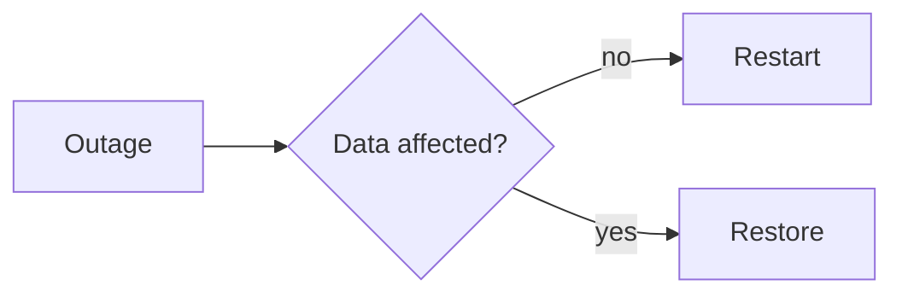

import { Aside, Steps } from '@astrojs/starlight/components';

Every asset has a **Documentation** tab. There you write guides, runbooks and recovery plans in Markdown, with diagrams and a preview beside the text. Every save creates a new version.

## Create a documentation

<Steps>

1. Open the asset and choose the **Documentation** tab.
2. Click **New documentation**, enter a title and choose a template and the confidentiality.
3. Click **Write**. The text is on the left, the preview on the right.
4. Click **Save**. Only then is the documentation created.

</Steps>

### Templates

| Template | Contents |
|---|---|
| Installation | purpose, prerequisites, steps, configuration, checks, changes |
| Runbook | overview with a diagram, contacts, dependencies, routine tasks, incidents, escalation |
| Disaster recovery | RTO and RPO, the flow as a diagram, backups, recovery, checks, last test |
| Maintenance and updates | maintenance window, preparation, steps, fallback plan, log |
| Decommissioning | reason, data, access and contracts, disposal |

The templates come in German and English, matching the language of the interface.

## Writing

The toolbar adds headings, bold text, lists, code, links and diagrams. You can also write Markdown directly:

````markdown
## Restart

1. Stop the service: `systemctl stop app`
2. **Check** that all connections have ended
- [ ] Backup available

| Service | Port |
|---|--:|
| Web | 443 |


````

**Load a Markdown file** takes an existing `.md` file into the editor. It is checked for size, encoding and open code blocks first.

<Aside type="note" title="No HTML">
HTML is not allowed in a documentation. Write angle brackets before letters, such as `<VirtualHost>`, in `code` or in a code block. Links lead to `https:` and `mailto:` only; images from the web are not loaded.
</Aside>

## Versions

**Versions** lists every saved version with its date. Open an older one to read it; **Take over as a new version** makes it the basis of a new version. Nothing is overwritten.

## Rights and confidentiality

A documentation is a document of the kind **Documentation**. The same rules as for files apply: encryption, confidentiality, location rights, retention and history. The roles administrator, information security and editor may write; whoever may see the asset reads its documentation up to the confidentiality their role allows. Every read is in the activity log.

## Diagrams

Write diagrams in a `mermaid` code block (flowcharts, sequences, states and more). They are drawn in an isolated frame without access to your session. If a diagram cannot be drawn, its source is shown.
