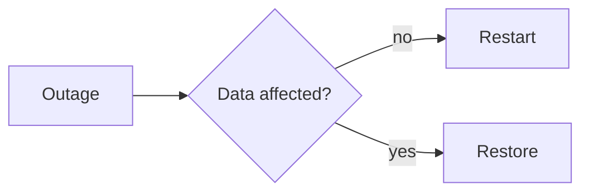

import { Aside, Steps } from '@astrojs/starlight/components';

Every asset and every location (building, floor, room) has a **Documentation** tab. There you write guides, runbooks and recovery plans in Markdown, with diagrams and a preview beside the text. Every save creates a new version.

## Create a documentation

<Steps>

1. Open the asset and choose the **Documentation** tab.
2. Click **New documentation**, enter a title and choose a template and the confidentiality.
3. Click **Write**. The text is on the left, the preview on the right.
4. Click **Save**. Only then is the documentation created.

</Steps>

### Templates

| Template | Contents |
|---|---|
| Installation | purpose, prerequisites, steps, configuration, checks, changes |
| Runbook | overview with a diagram, contacts, dependencies, routine tasks, incidents, escalation |
| Disaster recovery | RTO and RPO, the flow as a diagram, backups, recovery, checks, last test |
| Maintenance and updates | maintenance window, preparation, steps, fallback plan, log |
| Decommissioning | reason, data, access and contracts, disposal |

Locations have templates of their own:

| Template | Content |
|---|---|
| Site description | address and access, contacts, rooms, network and uplink with diagram |
| Server room or technical room | access, fire protection, cooling, power and UPS, monitoring, cabling, checks; following modules INF.2 and INF.5 of the IT-Grundschutz Compendium |
| Site emergency plan | emergency numbers, assembly point and evacuation, loss of power, network or cooling, restart |

Files such as floor plans, photos or inspection reports go under **Documents** at the location.

The templates come in German and English, matching the language of the interface.

## Writing

The toolbar adds headings, bold text, lists, code, links and diagrams. You can also write Markdown directly:

````markdown
## Restart

1. Stop the service: `systemctl stop app`
2. **Check** that all connections have ended
- [ ] Backup available

| Service | Port |
|---|--:|
| Web | 443 |


````

**Load a Markdown file** takes an existing `.md` file into the editor. It is checked for size, encoding and open code blocks first.

<Aside type="note" title="No HTML">
HTML is not allowed in a documentation, so that the file runs no script in other Markdown viewers either. Angle brackets before letters, such as in configuration examples like `VirtualHost`, belong in a code block that starts with three backticks at the start of the line and ends with exactly the same three backticks; the server does not take them in an inline code span or an indented block. Links lead to `https:`, `http:`, `mailto:` and paths only; images from the web are not loaded.
</Aside>

## Versions

**Versions** lists every saved version with its date. Open an older one to read it; **Take over as a new version** makes it the basis of a new version. Nothing is overwritten.

## Rights and confidentiality

A documentation is a document of the kind **Documentation**. The same rules as for files apply: encryption, confidentiality, location rights, retention and history. The roles administrator, information security and editor may write; whoever may see the asset reads its documentation up to the confidentiality their role allows. Every read is in the activity log.

## Using it as evidence

Many documentation entries show that requirements of the IT-Grundschutz are met, such as documenting servers, backups or recovery.

**In every edition** you link a documentation as evidence like any other document: in the Grundschutz check under **Evidence** with **Add evidence** and **Link an existing document**. At most 20 pieces of evidence count per requirement.

**With the [ISMS add-on](/en/pro/isms/)**, the aid below a requirement on **Check the implementation** proposes the matching documentation, in a collapsed section **Documentation of the assets as evidence**:

- It lists the documentation of the assets the requirement applies to, each with title, assets and last change. In the Edition 2023 these are the assets in operation the target object stands for (a single asset or a category with its subcategories); the information domain and locations have no proposals. In Grundschutz++ they are the assets in operation of the categories the requirement applies to in the information domain.
- **Read** opens the documentation on the **Documentation** tab of its asset. **Link as evidence** attaches it to the requirement; one already linked is marked **Linked as evidence**.
- The proposals load only when you open the section. At most 50 documentation entries are shown.
- You see only documentation up to your confidentiality level, and only with the rights to read the Grundschutz, the inventory and the documents.

Whether a documentation shows that the requirement is met is a person's decision; nothing is linked by itself. A linked documentation is evidence like any document: it appears among the ISMS evidence with a review date, a new version is marked “new version unchecked” there, and the document's page shows what it serves as evidence for. Without a license for the add-on the proposals go; existing links stay.

## Diagrams

Write diagrams in a `mermaid` code block (flowcharts, sequences, states and more). They are drawn in an isolated frame without access to your session. If a diagram cannot be drawn, its source is shown.
