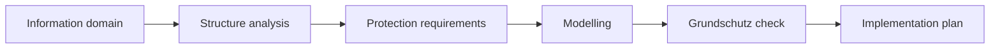

import { Aside, Steps } from '@astrojs/starlight/components';

SentryAssets guides you step by step through the IT-Grundschutz of the German Federal Office for Information Security (BSI), even without a security officer of your own. IT-Grundschutz is a collection of requirements with which you check whether your IT is adequately protected and record what is still missing. The basis is your inventory: **the inventory is the structure analysis.** You do not record assets, locations and relations a second time.

This guide is written for beginners. It follows exactly the steps the interface shows in the card **How to proceed** and explains each term as soon as it comes up. IT-Grundschutz is part of the Community edition; additions from Pro are listed under [What belongs to Pro](#what-belongs-to-pro).

<Aside type="caution" title="Support, not an audit">
SentryAssets helps with the process but does not replace an audit. Whether a requirement is met is your decision; an audit or certification remains the task of an auditor.
</Aside>

## Prerequisites

- A role with access to the Grundschutz: **Administrator**, **Information security**, **Editor**, **Data protection** or **Auditor (read only)**. The role **Read only** does not see the Grundschutz, as open requirements show where an organisation is vulnerable. What each role may do is listed under [Rights](#rights).
- A maintained inventory: assets with a **category** and a **location**. The category matters, as SentryAssets derives its proposals from it.
- The BSI file for your variant. You download it yourself; SentryAssets does not connect to the internet for this.

## Choosing the variant

The BSI currently offers IT-Grundschutz in two versions, and SentryAssets supports both. Open **IT-Grundschutz**. Under **Which variant suits you?** the page shows both versions side by side. At the top you choose under **Variant** between **Grundschutz++** and **Edition 2023**; the choice is part of the page address, so a bookmark always opens the same variant.

**In short:**

- **Edition 2023** if you are aiming for a certificate (ISO 27001 based on IT-Grundschutz) in the next few years or already have Grundschutz documentation. The method is mature and well described; you work with **modules** (Bausteine), such as “Windows Server” or “server room”, which you assign to your devices and rooms.
- **Grundschutz++** if you are starting without earlier documentation and want to aim at the BSI's coming version right away. You only choose which kinds of things you have and get a **requirement package** from that; you do not assign modules.

When in doubt, start with the variant your auditor, your customer or your industry recommends.

| | Grundschutz++ | Edition 2023 |
|---|---|---|
| Structure | 20 practices, such as governance, configuration or detection; requirements refer directly to target object categories | modules in layers (ISMS, applications, IT systems, networks, infrastructure), assigned to the target objects during modelling |
| Scope | about 1,000 requirements with MUST, SHOULD or MAY, each with a security level (normal or elevated) and an effort from 0 to 5 | more than 100 modules with basic, standard and requirements for high protection needs |
| Format | machine-readable (OSCAL), updated continuously | Kompendium as PDF and XML in yearly editions |
| Method | method guide of April 2026, still being trialled | BSI Standards 200-1 to 200-3 with basic, standard and core protection |
| Certification | expected from 2027 | ISO 27001 based on IT-Grundschutz, expected until the end of 2028 |
| Suited for | a start without earlier Grundschutz documentation, aiming at the coming version | anyone seeking a certificate now or continuing existing documentation |

As of October 2026 according to the BSI; dates for certification and transition may change.

## The BSI Standard 200-2 way

The terms in brief:

- **Information domain** (Informationsverbund): the part of your organisation you protect, with all its processes, applications, IT systems, rooms and people (BSI Standard 200-2, ch. 3.3). To begin with, this is usually the whole organisation.
- **Structure analysis:** recording what the information domain consists of. Its parts are called **target objects** (Zielobjekte).
- **Protection requirement** (Schutzbedarf): how bad a failure, a data leak or a falsification would be: normal, high or very high.
- **Modelling:** assigning the fitting modules to each target object (Edition 2023 only).
- **Grundschutz check:** recording for each requirement whether it is implemented.
- **Implementation plan:** what is still missing, with people responsible and due dates. Your answers in the Grundschutz check are its basis; the [ISMS add-on](/en/pro/isms/) adds the complete plan.

In the card **How to proceed** the page **IT-Grundschutz** shows where you stand: each step names its state, such as “not done yet”, and offers the matching button. Under **Tasks** SentryAssets reminds you of due steps, for the roles that may take them.

## Edition 2023 step by step

Choose **Edition 2023** under **Variant**. The card **How to proceed** leads in five steps from the information domain to the Grundschutz check.

### Importing the Kompendium

Before you start, SentryAssets needs the BSI's IT-Grundschutz-Kompendium. **Administrator** and **Information security** may import it.

<Steps>

1. In the card **IT-Grundschutz-Kompendium**, choose the link **Open the BSI page on the Kompendium**.

2. Download the “XML-Version des IT-Grundschutz-Kompendiums” there.

3. Choose **Import Kompendium** and the downloaded file.

</Steps>

SentryAssets checks the file completely before it stores it and then reports “Kompendium imported”. The card shows **Title**, **Edition**, the number of **Modules** and **Requirements** and the **Checksum (SHA-256)**. With **View modules** you browse the Kompendium, filtered by **Layer** and **Target object type**. When a new version appears, import it with **Import a new version**.

### Defining the information domain

The first step is called **What do you want to protect?**

<Steps>

1. Choose **Define the information domain**.

2. Enter a **Name** by which you recognise the domain. With **Use the proposal** you take a ready-made text for the **Scope** that covers the whole organisation.

3. Choose the **Approach**. It sets how thoroughly you proceed:
   - **Basic protection**: only the basic requirements. Recommended to begin with; you quickly protect what matters most and extend later.
   - **Standard protection**: the complete way, with which an ISO 27001 certificate based on IT-Grundschutz is possible.
   - **Core protection**: like standard protection, but first only for the most important processes and assets.

4. Choose **Save**.

</Steps>

You change the domain later with **Edit domain**.

### Recording target objects

The second step is called **What does it consist of?** Here you record the target objects, that is what the modules apply to. The information domain itself is already the first target object. On top come:

- **Category**: a group of like assets, such as all clients. This is the easiest way to cover many devices at once.
- **Asset**: a single, important system, such as the file server.
- **Location**: a building, room or data centre from your location tree.

<Steps>

1. In the card **Target objects**, choose **Add target object**.

2. Choose the **Kind of target object**: **Category**, **Asset** or **Location**.

3. Search for the object, for example with **Search category**, and choose it under **Matches**.

4. Choose **Add “…”**.

</Steps>

The list shows for each target object the number of assets in operation, the modules and the state of the check (“Check: … done”). You remove a target object on its page with **Remove target object**; the object in the inventory stays.

### Setting protection requirements

The third step is called **How much protection does it need?** Consider for each target object how bad a failure, a data leak or a falsification would be. **Normal is enough for most.** Without a choice, normal applies.

<Steps>

1. Open the target object from the list.

2. Choose a value under **Protection needs**: **normal protection needs**, **high protection needs** or **very high protection needs**.

</Steps>

With high or very high protection needs, the requirements for elevated protection also belong to the check, unless you chose basic protection.

Independently of this, you maintain the protection requirement of single assets per security goal (confidentiality, integrity, availability) in the inventory, also for many at once with **Set protection**. Locations follow the maximum principle: per goal the highest value of the assets there (BSI Standard 200-2, ch. 8.2).

### Assigning modules

The fourth step is called **Which modules fit?** A BSI module describes the requirements for a certain kind of object, such as a server or a server room. This assignment is called modelling.

<Steps>

1. Open a target object. Under **Suggestions** SentryAssets proposes fitting modules, each with a reason, such as “Fits the category of the inventory”, “Operating system …, as reported by the agent” or “Kind of location: …”.

2. Take over each fitting suggestion on its own with **Take …**.

3. If a module is missing, look for it under **Assign another module** with **Search modules**. Any module of the Kompendium can be assigned, also without a suggestion.

4. Check the list **Modelled modules**. You take out a wrong module with **Remove**.

</Steps>

A headquarters or branch without a building entered gets INF.1 like a building. A single asset without a category gets no suggestions, as the operating system alone does not tell a server from a client; the page leads straight there with **Choose the category at the asset**. With [Pro](/en/pro/modellierung/) you take over every suggestion at once.

### Grundschutz check of the target objects

The fifth step is called **What is implemented already?** The requirements of the modelled modules make up the check: the basic requirements in basic protection, otherwise the standard requirements too and, with a high protection need, those for high protection needs.

<Steps>

1. In the card **How to proceed**, choose **Continue the check**. It leads to the first target object with open requirements. Alternatively, open a target object and choose **Open the check** in the card **Grundschutz check**.

2. Under **Module**, choose the module you want to work on. With **Open** you hide what is already answered.

3. Read the **Text of the requirement** if needed. A badge shows the level: **Basic** (implement first), **Standard** or **High protection need**.

4. Answer the requirement as described under [The Grundschutz check: how to answer](#the-grundschutz-check-how-to-answer).

5. Go back with **To the target object** and work through the next target object.

</Steps>

## Grundschutz++ step by step

Choose **Grundschutz++** under **Variant**. The card **How to proceed** leads in four steps from the BSI catalogue to where you stand.

### Importing the catalogue

**Administrator** and **Information security** may import it.

<Steps>

1. In the card **Grundschutz++ catalog**, choose the link **Open the file at the BSI**. It is the file `Grundschutz++-resolved_catalog.json` in the BSI's state-of-the-art library.

2. Save it there with “Download raw file”.

3. Choose **Import catalog** and the saved file.

</Steps>

SentryAssets checks the file completely and reports “Catalog imported”. The card shows **Version of**, **Imported on**, the number of **Requirements** and the **Checksum**. With **View requirements** you look up the whole catalogue, filtered by **Practice**, **Modality**, **Security level** and **Target object**. You import a new version with **Import a new version**.

### Information domain and requirement package

The first step is called **What do you want to protect?** From the information domain SentryAssets builds your **requirement package**, that is the requirements that apply to you.

<Steps>

1. Choose **Define the information domain**.

2. Enter **Name** and **Scope**, or take the text with **Use the proposal**.

3. Decide on two tick boxes. To begin with, the interface recommends leaving both unticked:
   - **Include requirements for the raised security level as well** only if you process particularly sensitive information, such as health, personnel or financial data on a large scale, or customers and regulations require it.
   - **Include KANN requirements**: KANN (MAY) requirements are voluntary extra measures. Implement the MUSS (MUST) and SOLLTE (SHOULD) requirements first.

4. Choose **Save**.

</Steps>

The card **Information domain** then shows **Security level** and **KANN requirements**; you can change both at any time with **Edit the information domain**.

### Choosing target objects

The second step is called **What does it consist of?** In Grundschutz++ you do not choose single devices but **target object categories**, that is kinds of things, such as IT systems, applications or rooms. Only requirements that fit these categories go into the package. Without a chosen category, the package holds only the requirements for the whole domain.

<Steps>

1. Choose **Choose target objects**.

2. Under **Suggestions from inventory and locations** SentryAssets names categories with the number of matching assets in operation, or locations. Some are marked “exists in every institution”.

3. Take over each fitting suggestion with **Take …**. It then shows as “chosen”.

4. If a category is missing, select it under **Another category** and confirm with **Add**. The list shows for each category how many requirements it brings along.

</Steps>

You do not assign your assets one by one here: the suggestions come from the categories in your inventory and from your locations. So maintain the categories in the inventory first.

### Setting parameters

The third step is called **Set your rules**. Some requirements leave a place open that your organisation fills itself: how often something happens, who is responsible or which standard is followed.

<Steps>

1. Choose **Set parameters**. The page **Parameters** shows the parameters of the requirements in your package; with **Open** you see only what is still missing.

2. Read the short explanation for each parameter, for a deadline for example “How long or by when?”, and the **Place in the requirement**.

3. Enter your value under **Your value instead of “…”** or choose one of the **Proposals:**. The proposals stay German, as they take the place of words in the BSI's German text.

4. Choose **Save**.

</Steps>

If a field stays empty, the BSI's wording applies. Your value then stands in the requirement, in the Grundschutz check and in the export and is kept across new catalogue versions. Choose values you will really keep up: a yearly rhythm kept is better than a monthly one missed.

### Checking the implementation

The fourth step is called **What is implemented already?** Go through your package and state for each requirement whether it is implemented.

<Steps>

1. Choose **Check the implementation** in the card **How to proceed**, or **Check the implementation** in the card **Requirement package**. The page **Check the implementation** shows the **Grundschutz check**.

2. Choose a practice under **Practice**. With **Open** you hide what is already answered; once everything is done, it says “Nothing is open here any more.”

3. For a requirement, open **What does it mean? How do you tell?**. It explains the modality (MUSS: must be met in any case; SOLLTE: normally met, justify deviations soundly; KANN: useful depending on the situation), the **Expected result:** and the **Suitable proof:**. The text already contains your parameter values.

4. Answer the requirement as described in the next section.

</Steps>

You can also open a requirement from **View requirements**: its card **Implementation at your organisation** shows the same answer as under **Check the implementation**.

## The Grundschutz check: how to answer

In both variants you answer each requirement the same way. At the top of the page, **How to assess a requirement** explains when each answer is right:

| Answer | When it is right | What you add |
|---|---|---|
| **Yes** | Implemented, and you could show it to someone: a document, a setting or a procedure that is really lived that way. | nothing; ideally link evidence |
| **Partly** | Started or implemented for a part only, for example at one of two sites. | **What is still missing? (optional)**, **Responsible**, **Implement by** |
| **No** | Not implemented yet. | **What is still missing? (optional)**, **Responsible**, **Implement by** |
| **Not applicable** | Does not apply to you, for example because the technology or procedure concerned does not exist. For MUSS requirements this is rare. | **Why not applicable? (required)** |

<Steps>

1. Choose **Yes**, **Partly**, **No** or **Not applicable** for the requirement. The answer is saved at once; the message offers **Undo**.

2. With **Partly** or **No**, further fields appear. Note under **What is still missing? (optional)** what needs doing, choose a person from your owners under **Responsible** and set a date under **Implement by**. Choose **Save**.

3. With **Not applicable**, enter the reason under **Why not applicable? (required)** and choose **Save**. Without a reason nothing is saved: not applicable needs a reason.

</Steps>

**When in doubt, choose “Partly”** and note what is missing: it is more honest than a “Yes” and shows what to do.

**When does something count as fulfilled?** As soon as you assess a requirement with **Yes**. **Not applicable** with a reason also counts as done; **Partly** and **No** show what is left to do. This makes the progress.

### Linking evidence

Evidence shows that a requirement is implemented: for example a decision of the management, minutes, a report or a screenshot of a setting. The files are kept with the documents and linked in the check.

<Steps>

1. Open **Add evidence** for the requirement (or the number of pieces of evidence, if some are linked already).

2. Choose **Upload a new document** to store a file and link it right away. Title and kind are proposed.

3. Or choose **Link an existing document**, search under **Search documents** and choose **Link**.

</Steps>

With **Remove** you take a piece of evidence out again; the document stays. With Grundschutz++ the section also names what the BSI suggests as evidence. A document's page shows what it serves as evidence for.

## Progress and due dates

- At the top, the check shows **Assessed** with “… of … assessed”, and so does each practice or module.
- With Edition 2023 each target object shows “… of … requirements implemented or not applicable”; the card **How to proceed** counts the assessed requirements across all target objects.
- With Grundschutz++ the card **Requirement package** shows the count per state: open, implemented, partly, not implemented, not applicable.
- A passed due date is marked **overdue**. Due and overdue dates appear as tasks. With Grundschutz++ the task opens the check filtered by **Past due date** or **Due within 30 days**; **Clear filter** shows everything again. With Edition 2023 it leads to the page **IT-Grundschutz**, where the list of target objects names passed due dates per target object.
- With Grundschutz++ you export the requirement package with its implementation state under **Check the implementation** with **Export CSV**.
- If a new Grundschutz++ catalogue no longer contains a requirement or parameter, the page names the entries concerned; you delete them with **Remove** and **Remove for good**. This cannot be undone; the audit log records it.

## Rights

| Role | Grundschutz |
|---|---|
| Administrator, Information security | everything: import catalogue and Kompendium, define the information domain, target objects, parameters, answer the check, evidence |
| Editor | view and answer the check |
| Data protection, Auditor (read only) | view only |
| Read only | no access |

Both variants use the same rights. From Pro you adapt rights in [custom roles](/en/pro/rollen-anpassen/).

## Notes and limits

- Catalogue and Kompendium file: at most 16 MB. If a reverse proxy sits in front of SentryAssets, it must allow at least 16 MB for this upload.
- Edition 2023: at most 500 target objects and 200 modules per target object. Group like assets in a category.
- At most 20 pieces of evidence per requirement; best combine records in one document.
- Parameter values: at most 500 characters on one line.

## Example: RECPLAST GmbH

RECPLAST GmbH is the BSI's example company. In SentryAssets its way with Edition 2023 could look like this:

1. Information domain "RECPLAST overall" with the head office and the production site as locations, basic protection.
2. The agents discover servers and clients; the collector finds printers and switches. The categories "Server", "Clients" and "Network" become target objects.
3. The file server gets protection requirement "high" for confidentiality, as design data are stored there; the head office takes this value over by the maximum principle.
4. SentryAssets proposes the matching modules for the Windows servers and the module for server rooms for the server room.
5. In the Grundschutz check the security officer attaches the approved backup concept as evidence.

## What belongs to Pro

The Community edition contains the whole guided way. From Pro you also get:

- [Inheriting protection requirements](/en/pro/schutzbedarf/) along the dependencies.
- [Automatic modelling](/en/pro/modellierung/): take over all suggestions at once.
- [Approvals in the Grundschutz check](/en/pro/freigaben/) after the four-eyes principle.
- [Check rules](/en/pro/pruefregeln/) that check requirements against the inventory data.
- The [ISMS add-on](/en/pro/isms/) adds the policy, risk analysis after BSI Standard 200-3, the implementation plan and the reference documents A.0 to A.6.

## Further reading

- The [Help assistant](/en/reference/ki-assistent/) answers questions on the Kompendium with sources.
