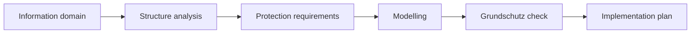

import { Aside, Steps } from '@astrojs/starlight/components';

SentryAssets guides you step by step through the IT-Grundschutz of the German Federal Office for Information Security (BSI), even without a security officer of your own. The basis is your inventory: **the inventory is the structure analysis.** You do not record assets, locations and relations a second time.

<Aside type="caution" title="Support, not an audit">
SentryAssets helps with the process but does not replace an audit. Whether a requirement is met is your decision; an audit or certification remains the task of an auditor.
</Aside>

## Choosing the variant

SentryAssets supports both variants of the IT-Grundschutz. Under **IT-Grundschutz** an overview compares them.

| | Grundschutz++ | Edition 2023 |
|---|---|---|
| Structure | 20 practices, such as governance, configuration or detection; requirements refer directly to target object categories | modules in layers (ISMS, applications, IT systems, networks, infrastructure), assigned to the target objects during modelling |
| Scope | about 1,000 requirements with MUST, SHOULD or MAY, each with a security level (normal or elevated) and an effort from 0 to 5 | more than 100 modules with basic, standard and requirements for high protection needs |
| Format | machine-readable (OSCAL), updated continuously | Kompendium as PDF and XML in yearly editions |
| Method | method guide of April 2026, still being trialled | BSI Standards 200-1 to 200-3 with basic, standard and core protection |
| Certification | expected from 2027 | ISO 27001 based on IT-Grundschutz, expected until the end of 2028 |
| Suited for | a start without earlier Grundschutz documentation, aiming at the coming version | anyone seeking a certificate now or continuing existing documentation |

As of October 2026 according to the BSI; dates for certification and transition may change.

You download both catalogues from the BSI yourself and import them; SentryAssets checks the file completely before it stores it.

## The BSI Standard 200-2 way

The page **IT-Grundschutz** shows where you stand and names the one next step. Under **Tasks** SentryAssets reminds of that step, for the roles that may take it.

<Steps>

1. **Define the information domain.** The information domain (Informationsverbund) covers all processes, applications, IT systems, rooms and people you look at together (BSI Standard 200-2, ch. 3.3). The dialog explains what belongs to it and proposes a name and scope. For Grundschutz++ you choose security level and modality, for Edition 2023 the approach (basic, standard or core protection); to start with, the dialog recommends basic protection.

2. **Structure analysis from the inventory.** The target objects (Zielobjekte) come from your inventory: the information domain itself, categories as groups of similar assets, single assets and locations. For Grundschutz++ SentryAssets proposes the target object categories from inventory and locations.

3. **Determine the protection requirements.** Per security goal (confidentiality, integrity, availability) you set the protection requirement (Schutzbedarf): normal, high or very high. Locations follow the maximum principle: per goal the highest value of the assets there (BSI Standard 200-2, ch. 8.2). With [Pro](/en/pro/schutzbedarf/) SentryAssets inherits protection requirements along the dependencies.

4. **Model.** For Edition 2023 SentryAssets proposes modules from the category, the operating systems the agents report and the kind of location, each with its reason; a headquarters or branch without a building entered gets INF.1 like a building. An asset in “Unassigned” gets proposals only once it has a category, as the operating system alone does not tell a server from a client; the page leads straight there. you take them over one at a time or assign others by search. For Grundschutz++ the requirement package follows from the information domain. With [Pro](/en/pro/modellierung/) you take every proposal over at once.

5. **Set parameters** (Grundschutz++). Some requirements contain parameters, such as a deadline. Each parameter says what kind of value is asked for, with fitting proposals; your values are kept across new catalogue versions and appear in the requirement texts.

6. **Grundschutz check.** Per requirement you record the state: implemented, partly, not implemented or **not applicable** (only with a reason), plus responsible person, due date and note. A legend says when each answer is right; each Grundschutz++ requirement explains its text with your values, the expected result and suitable evidence.

7. **Link evidence.** Documents that show an implementation, such as the management's decision, are attached to the state of a requirement, existing ones or uploaded right away. A document's page shows what it serves as evidence for.

</Steps>

## Progress and due dates

- The **overview** shows progress per practice or module and target object.
- Due and overdue dates appear as tasks.
- Export the requirement package with its implementation state as CSV.
- Entries whose requirement or parameter a newer catalogue no longer contains can be removed.

## Example: RECPLAST GmbH

RECPLAST GmbH is the BSI's example company. In SentryAssets its way could look like this:

1. Information domain "RECPLAST overall" with the head office and the production site as locations, basic protection.
2. The agents discover servers and clients; the collector finds printers and switches. The categories "Server", "Clients" and "Network" become target objects.
3. The file server gets protection requirement "high" for confidentiality, as design data are stored there; the head office takes this value over by the maximum principle.
4. SentryAssets proposes the matching modules for the Windows servers and the module for server rooms for the server room.
5. In the Grundschutz check the security officer attaches the approved backup concept as evidence.

## Further reading

- The [ISMS add-on](/en/pro/isms/) adds the policy, risk analysis after BSI Standard 200-3, the implementation plan and the reference documents A.0 to A.6.
- [Approvals in the Grundschutz check](/en/pro/freigaben/) after the four-eyes principle (Pro).
- The [Help assistant](/en/reference/ki-assistent/) answers questions on the Kompendium with sources.
