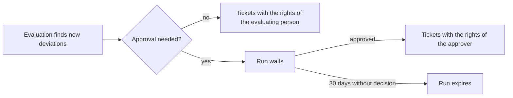

import { Badge } from '@astrojs/starlight/components';

<Badge text="Pro" variant="note" /> This feature is available from the Pro edition.

A workflow turns new deviations from [check rules](/en/pro/pruefregeln/) into [tickets](/en/pro/tickets/) without manual work.

## A workflow sets

- the rules it reacts to (or all);
- the minimum severity;
- the ticket system and the language of its tickets;
- how many tickets one run may make (20 at most);
- whether it runs at once or waits for an approval.

## Process

- A workflow starts as soon as an evaluation by administration or information security keeps new deviations.
- Each ticket is checked as if created by hand.
- One evaluation makes 50 tickets at most; deviations beyond a limit are counted as skipped.
- A failing workflow never stops the evaluation.

## Switching on and result

- A workflow can be switched on only with a connection that is on and tested on the page **Tickets**. A switched-on workflow cannot be moved to a connection that is not ready.
- If the connection is switched off later, the workflow's card shows "Connection not ready" with a note; until the connection is ready again, no tickets are created.
- A run that created no ticket appears as "No ticket created" in the list, one with fewer tickets than assets as "Partly run", each with its reasons below.
