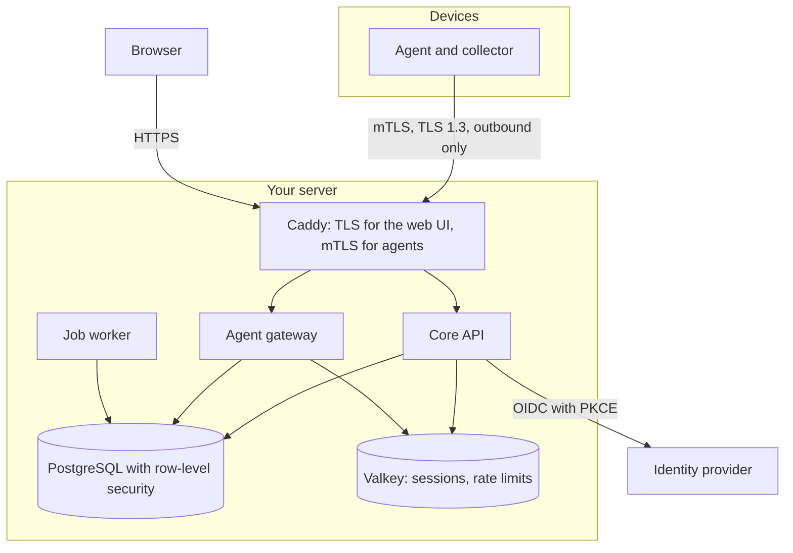

SentryAssets is a **modular monolith**: one backend application with clearly separated modules, a job worker, a web UI and an agent for devices.

## Services

| Service | Task |
|---|---|
| `caddy` | TLS termination, serving the web UI, mTLS check of the agents, agent downloads |
| `api` | business logic, REST API for the web UI and integrations, sign-in as backend-for-frontend |
| `gateway` | accepting agent data, enrolment, issuing and renewing certificates; a process of its own with its own rights |
| `worker` | background jobs: syncs, notifications, audit chain checks, revocation lists, connectors |
| `postgres` | data storage; every business table with a tenant ID and row-level security |
| `valkey` | sessions, sign-in flows, rate limits |
| `migrate` | creates and updates the database schema, runs once and exits |
| `cli`, `backup` | tools for setup, PKI, emergency access, audit check and backup |
| `clamav` | optional virus scanner without a network, through a socket |

## Ground rules

- **API and gateway are separate processes** with separate database roles and no shared network. A compromised agent endpoint reaches neither the web UI's sessions nor the API.
- **Tenant isolation** with row-level security in PostgreSQL and in every service call as well. The application's database role does not own the tables.
- **Separate database roles** for migration, API, gateway, worker and backup.
- **Every write** creates an entry in the audit log with a hash chain.
- **Extensions** (Pro, Enterprise, ISMS add-on) are loaded through a plugin interface; the core has no branches by edition.

## Networks

The Compose file puts the containers into networks of their own with fixed ranges within `172.30.248.0/21`:

| Network | Who | Outbound |
|---|---|---|
| `edge` | Caddy | yes: published ports and ACME |
| `ui-proxy` | Caddy and API | no |
| `agent-proxy` | Caddy and gateway | no |
| `data` | API, worker, migration, tools with PostgreSQL and Valkey | no |
| `gateway-data` | gateway with PostgreSQL and Valkey | no |
| `egress` | API and worker, for the identity provider and connectors | yes |

The gateway has no way out. Every container runs without root rights, with a read-only file system, without capabilities and with resource limits.

## Agent connection

- Caddy checks the client certificate (mTLS with TLS 1.3) and passes it on in a header it always overwrites. The gateway checks the certificate again itself: chain, validity and revocation list.
- An agent's identity and tenant come **only** from the verified certificate, never from the payload.
- Every message carries a time and a sequence number; repeated or outdated messages are dropped (replay protection). Sizes, decompressed sizes and rates are limited.

More on security under [Security](/en/reference/sicherheit/), on several instances under [High availability](/en/pro/hochverfuegbarkeit/).
