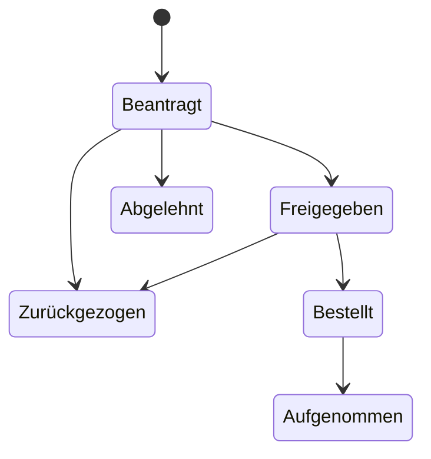
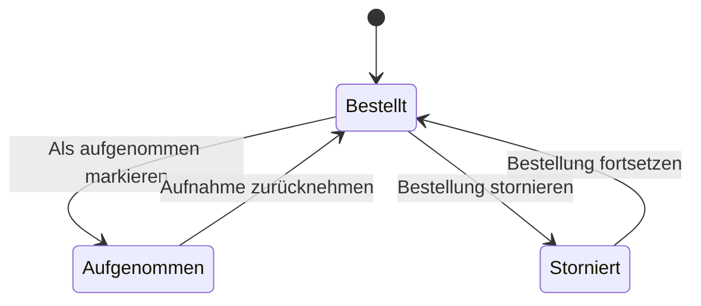

import { Aside, Badge, Steps } from '@astrojs/starlight/components';

Unter **Inventar › Beschaffung** führen Sie Beschaffungsanträge vom Antrag bis zur Aufnahme ins Inventar: was beschafft werden soll, für welche Abteilung und welchen Standort, zu welchem Preis, und wie die Geschäftsleitung entschieden hat. Ein Antrag lässt sich zur Unterschrift drucken, als PDF speichern oder mit dem PDF im Anhang per E-Mail senden. Nach der Freigabe verknüpfen Sie ihn mit den Assets und dem Verbrauchsmaterial, die er gebracht hat.

Was ohne Antrag sofort bestellt wird, etwa Toner oder Kabel, erfassen Sie als [Bestellung](#bestellungen-ohne-antrag). Beim [Wareneingang](#wareneingang-einbuchen) buchen Antrag und Bestellung das gelieferte Verbrauchsmaterial gleich in den Bestand.

Die Beschaffung gehört zur Community-Edition. Ab Pro kommen der [Bestellvorschlag](#bestellvorschlag) aus dem Mindestbestand und das [Anlegen von Geräten als Assets](#geräte-als-assets-anlegen) beim Wareneingang dazu. Kostenstellen ordnen Sie Anträgen und Bestellungen wie unter [Kostenstellen](/guides/kostenstellen/) beschrieben zu.

## Voraussetzungen

- Eine Rolle mit Schreibrecht für die Beschaffung: **Administrator**, **Informationssicherheit** oder **Bearbeitung**. Alle anderen Rollen sehen die Anträge nur (siehe [Rechte](#rechte)).
- Für die Druckvorlage mit Briefkopf: ein [Logo der Organisation](#logo-der-organisation-für-die-druckvorlage).
- Für das unterschriebene Exemplar: ein eingerichteter Speicher für Dokumente.

## Antrag anlegen

<Steps>

1. Öffnen Sie **Inventar › Beschaffung** und wählen Sie **Antrag anlegen**.

2. Tragen Sie unter **Abteilung und Standort** die **Abteilung**, den **Standort**, den **Antragsteller** und das **Datum des Antrags** ein. Der Antragsteller ist mit Ihrem Namen vorbelegt.

3. Beschreiben Sie unter **Worum es geht** den **Betreff**, etwa „Ausstattung für die Kabelbeschriftung“, und die **Begründung**: warum die Beschaffung nötig ist und was sonst für die Entscheidung zählt.

4. Legen Sie unter **Positionen** jede Position an. Mit **Position hinzufügen** kommt eine weitere dazu, mit **Entfernen** fällt eine weg. Je Position:
   - **Bezeichnung** und **Art** (**Gerät oder Asset**, **Verbrauchsmaterial**, **Dienstleistung** oder **Sonstiges**);
   - bei der Art **Verbrauchsmaterial** optional den Artikel unter **Verbrauchsmaterial** (siehe [Positionen mit Verbrauchsmaterial](#positionen-mit-verbrauchsmaterial));
   - **Artikelnummer** und **Artikelbeschreibung**;
   - **Anzahl** und **Einzelpreis**.

   Den **Gesamtpreis** je Position und für den ganzen Antrag rechnet die Seite schon beim Tippen.

5. Wählen Sie unter **Kosten** den **Lieferant**, tragen Sie das **Angebot** ein (Nummer oder Bezeichnung) und legen Sie unter **Preis** fest, ob die Beträge **brutto** oder **netto** gelten. Das gilt für alle Positionen.

6. Wählen Sie **Antrag anlegen**.

</Steps>

Ein Antrag hat 1 bis 100 Positionen; die Anzahl liegt je Position zwischen 1 und 100 000, der Gesamtpreis bei höchstens 1 Milliarde Euro. Fehlt ein Lieferant in der Auswahl, legen Sie ihn dort direkt an, sofern Sie Lieferanten anlegen dürfen.

### Nummern

Jeder Antrag bekommt eine laufende Nummer in Ihrer Organisation, etwa `BA-0001`. [Bestellungen](#bestellungen-ohne-antrag) werden getrennt davon gezählt und tragen das Kürzel `BE`, etwa `BE-0001`; am Kürzel sehen Sie, ob eine Freigabe dahintersteht. Eine Nummer wird nie ein zweites Mal vergeben, auch nicht nach dem Löschen, weil ein unterschriebenes Papier oder eine Buchung im Verbrauchsmaterial sie nennen kann.

Die Suche findet Anträge und Bestellungen über Betreff, Abteilung und Antragsteller sowie über Bezeichnung und Artikelnummer ihrer Positionen. Der Filter **Art** zeigt **Alle**, nur **Anträge** oder nur **Bestellungen**, der Filter **Status** grenzt die Liste weiter ein.

## Status und erlaubte Wechsel

| Status | Bedeutung |
|---|---|
| **Beantragt** | Der Antrag wartet auf die Entscheidung. |
| **Freigegeben** | Die Geschäftsleitung hat zugestimmt. |
| **Abgelehnt** | Die Geschäftsleitung hat abgelehnt; der Grund steht am Antrag. |
| **Bestellt** | Die Bestellung ist aufgegeben. |
| **Im Inventar aufgenommen** | Geliefert und ins Inventar übernommen. |
| **Zurückgezogen** | Der Antrag wird nicht weiter verfolgt. |

Die Schritte stehen auf der Seite des Antrags unter **Stand**: **Freigabe erfassen**, **Ablehnung erfassen**, **Antrag zurückziehen**, **Als bestellt markieren** und **Als aufgenommen markieren**. Freigabe, Ablehnung, Bestellung und Aufnahme tragen ihr Datum. Andere Wechsel nimmt der Server nicht an.

Je Status gibt es außerdem genau einen Schritt zurück, damit sich ein Versehen beheben lässt, etwa **Freigabe zurücknehmen**, **Bestellung zurücknehmen** oder **Wieder öffnen** für einen zurückgezogenen Antrag.

**Löschen** lässt sich ein Antrag nur, solange nichts bestellt ist: als **Beantragt**, **Abgelehnt** oder **Zurückgezogen**. Im Audit-Log bleibt er vermerkt.

## Positionen mit Verbrauchsmaterial

Eine Position der Art **Verbrauchsmaterial** kann den Artikel nennen, den sie meint, etwa „Toner HP 26X“. Wählen Sie ihn im Dialog des Antrags oder der Bestellung unter **Verbrauchsmaterial**; **Nicht zugeordnet** lässt die Position ohne Artikel. Zur Auswahl stehen die Artikel Ihrer Organisation, die Sie sehen dürfen.

Eine zugeordnete Position bucht der [Wareneingang](#wareneingang-einbuchen) in den Bestand des Artikels ein. Ohne Zuordnung bleibt sie eine reine Zeile der Kostenaufstellung.

## Bestellungen ohne Antrag

Verbrauchsmaterial und Kleinbedarf werden oft sofort bestellt, ohne dass die Geschäftsleitung zustimmen muss. Dafür gibt es neben dem Antrag die Bestellung. Sie hat dieselben Angaben wie ein Antrag, aber keine Freigabe.

<Steps>

1. Öffnen Sie **Inventar › Beschaffung** und wählen Sie **Bestellung anlegen**.

2. Tragen Sie unter **Abteilung und Standort** die **Abteilung**, den **Standort**, **Bestellt von** und **Bestellt am** ein. Die Bestellung gilt ab diesem Datum als bestellt.

3. Füllen Sie **Worum es geht**, **Positionen** und **Kosten** aus wie bei einem [Antrag](#antrag-anlegen). Ordnen Sie Positionen der Art **Verbrauchsmaterial** ihrem Artikel zu, wenn der Wareneingang sie einbuchen soll.

4. Wählen Sie **Bestellung anlegen**.

</Steps>

Die Bestellung bekommt eine Nummer mit dem Kürzel `BE` und steht in der Liste neben den Anträgen.

### Status einer Bestellung

| Status | Bedeutung |
|---|---|
| **Bestellt** | Die Bestellung ist aufgegeben; so beginnt jede Bestellung. |
| **Im Inventar aufgenommen** | Geliefert und ins Inventar übernommen. |
| **Storniert** | Die Bestellung wird nicht weiter verfolgt. |

- **Bestellung stornieren** beendet eine Bestellung, **Bestellung fortsetzen** holt sie zurück auf **Bestellt**.
- **Als aufgenommen markieren** erfasst den [Wareneingang](#wareneingang-einbuchen); **Aufnahme zurücknehmen** nimmt ihn zurück.
- Bis zum Eingang ändern Sie den Inhalt frei. Ist die Bestellung aufgenommen oder storniert, bleiben Positionen, Lieferant, Angebot und Preis, wie sie waren; **Abteilung**, **Standort** und **Bestellt von** können Sie weiter ändern.
- **Löschen** lässt sich eine Bestellung erst, wenn sie storniert ist. Im Audit-Log bleibt sie vermerkt.

### Drucken, PDF und E-Mail

Eine Bestellung druckt, speichert und versendet sich wie ein Antrag mit **Drucken**, **Als PDF** und **Per E-Mail senden** (siehe [Als PDF und per E-Mail](#als-pdf-und-per-e-mail)). Die Vorlage heißt **Bestellung**, die Datei etwa `Bestellung-BE-0003.pdf`. Einen Kasten **Genehmigung** gibt es dort nicht, und ein unterschriebenes Exemplar lässt sich an eine Bestellung nicht hängen.

## Freigabe auf Papier

Viele Geschäftsleitungen unterschreiben lieber auf Papier. Dafür gibt es die Druckvorlage.

<Steps>

1. Öffnen Sie den Antrag und wählen Sie **Drucken**. Die Vorlage zeigt im Kopf das Logo Ihrer Organisation, Abteilung und Standort, die Beschreibung, die Kostenaufstellung und einen Kasten **Genehmigung** mit ja oder nein, Ablehnungsgrund, **Ort, Datum** und **Unterschrift der Geschäftsleitung**.

2. Drucken Sie den Antrag oder wählen Sie im Druckdialog „Als PDF speichern“, und legen Sie ihn der Geschäftsleitung vor.

3. Scannen Sie das unterschriebene Exemplar und wählen Sie am Antrag unter **Unterschriebenes Exemplar** die Schaltfläche **Unterschriebenes Exemplar hochladen**. Die Datei wird als Dokument der Art **Nachweis** abgelegt und mit dem Antrag verknüpft; die Seite des Dokuments nennt den Antrag als Verwendung.

4. Erfassen Sie die Entscheidung, wie sie auf dem Papier steht: **Freigabe erfassen** mit dem **Datum der Freigabe** oder **Ablehnung erfassen** mit Datum und **Ablehnungsgrund**.

</Steps>

Ist die Entscheidung schon erfasst, ist sie auf der Druckvorlage angekreuzt. Mit **Exemplar ersetzen** tauschen Sie die Datei aus, mit **Verknüpfung lösen** trennen Sie sie vom Antrag. Wird das Dokument gelöscht, verliert der Antrag die Verknüpfung mit einem Eintrag im Audit-Log.

## Freigabe in der App

Unterschreibt die Geschäftsleitung nicht auf Papier, erfasst eine Person mit Schreibrecht die Entscheidung direkt mit **Freigabe erfassen** oder **Ablehnung erfassen**. Eine Ablehnung braucht immer einen Grund; ein Grund wird nur zusammen mit einer Ablehnung angenommen.

<Aside type="caution" title="Ein Vermerk, keine Berechtigungsprüfung">
Der Status **Freigegeben** hält die Entscheidung der Geschäftsleitung fest. Er ist keine technische Freigabe mit vier Augen: Wer Anträge schreiben darf, kann ihn setzen, auch für einen eigenen Antrag. Maßgeblich ist die Entscheidung der Geschäftsleitung, etwa die Unterschrift auf dem Papier. Jeder Statuswechsel steht mit Person und Zeitpunkt im Audit-Log.
</Aside>

## Änderungen an einem freigegebenen Antrag

Die Freigabe gilt für den Inhalt, den die Geschäftsleitung gesehen hat.

- **Freigegeben:** Ändern Sie Bezeichnung, Art, Anzahl, Beschreibung, Lieferant, Angebot, Preis oder die Positionen, geht der Antrag zurück auf **Beantragt** und braucht eine neue Freigabe. Die Verknüpfung zum unterschriebenen Exemplar wird dabei gelöst, weil es den alten Stand freigab.
- **Bestellt, Im Inventar aufgenommen, Abgelehnt oder Zurückgezogen:** Inhalt und Preis ändern sich nicht mehr. **Abteilung**, **Standort** und **Antragsteller** können Sie weiter ändern.

Bearbeiten zwei Personen denselben Antrag gleichzeitig, nimmt der Server nur die erste Änderung an; die zweite erhält die Meldung „Der Antrag wurde inzwischen geändert. Bitte laden Sie die Seite neu.“

## Als PDF und per E-Mail

Auf der Seite des Antrags stehen neben **Drucken** weitere Wege. Das PDF entsteht immer im Browser, gestaltet wie die Druckvorlage mit Logo, Positionen und Kasten **Genehmigung**.

- **Als PDF** speichert den Antrag als PDF-Datei, etwa `Beschaffungsantrag-BA-0001.pdf`.
- **Per E-Mail senden** schickt den Antrag mit dem PDF im Anhang über den Mailserver Ihrer Organisation. Die Schaltfläche erscheint, sobald der [Mailserver eingerichtet](/guides/benachrichtigungen/#mailserver-einrichten) ist und Domänen für den Versand freigegeben sind, und nur für Rollen, die den Antrag ändern dürfen.
- **ohne Anhang** öffnet Ihr eigenes Mailprogramm mit Betreff, Zusammenfassung und Link, aber ohne PDF. Diesen Weg gibt es, solange der Versand über den Mailserver nicht eingerichtet ist; rechts unter **Stand** sagt dann ein Hinweis, was fehlt.

### Per E-Mail senden

<Steps>

1. Wählen Sie auf der Seite des Antrags **Per E-Mail senden**.

2. Tragen Sie unter **Empfänger** eine bis fünf Adressen ein, durch Komma getrennt. Erlaubt sind nur Adressen in den Domänen, die die Administration freigegeben hat; der Dialog nennt sie.

3. Schreiben Sie bei Bedarf eine **Nachricht**, höchstens 1.000 Zeichen, und wählen Sie **Senden**.

</Steps>

Betreff und Text stellt SentryAssets aus dem Antrag zusammen: Nummer, Betreff, Antragsteller, Summe und ein Link zum Antrag, dazu Ihre Nachricht und Ihr Name. Antworten gehen an Ihre eigene Adresse, Absender bleibt der eingerichtete. Gesendet wird im Hintergrund; ein Hinweis meldet, sobald die Mail beim Mailserver ist, oder warum nicht. Nimmt der Mailserver nur einen Teil der Empfänger an, sagt der Hinweis das.

Die Grenzen: höchstens 5 Empfänger je Versand, 20 Versände je Person und Stunde und 200 je Organisation und Tag; Adressen mit `%` oder `!` vor dem `@` werden abgelehnt. Das PDF wird wie ein hochgeladenes Dokument geprüft, bis zum Versand verschlüsselt gehalten und danach gelöscht. Das Audit-Log nennt die Zahl der Empfänger und ihre Domänen, nie eine Adresse oder die Nachricht.

## Mit dem Inventar verknüpfen

Ab der Freigabe zeigt der Antrag die Karte **Im Inventar**: was er gebracht hat. Eine Bestellung zeigt sie von Anfang an.

<Steps>

1. Wählen Sie **Asset anlegen**. Der Dialog für ein neues Asset beginnt mit Bezeichnung, Standort und Lieferant des Antrags; das neue Asset wird gleich mit dem Antrag verknüpft.

2. Oder wählen Sie **Vorhandenes zuordnen**, die **Art** (**Asset** oder **Verbrauchsmaterial**), suchen Sie nach dem Namen und wählen Sie bei einem Treffer **Zuordnen**.

3. Wenn alles geliefert ist, wählen Sie **Als aufgenommen markieren** mit dem **Datum der Aufnahme**.

</Steps>

Ein Antrag nennt höchstens 1 000 Assets und Artikel, jeden einmal. Verknüpfen ändert das Asset nicht. **Entfernen** löst eine Verknüpfung; wird ein verknüpftes Asset oder ein Artikel gelöscht, verschwindet die Verknüpfung mit einem Eintrag im Audit-Log des Antrags.

### Geräte als Assets anlegen

<Badge text="Pro" variant="note" /> Dieser Abschnitt gilt ab der Edition Pro.

Kommen zehn Notebooks, legen Sie sie in einem Schritt als zehn Assets an. Ab **Freigegeben**, also auch bei **Bestellt** und **Im Inventar aufgenommen**, zeigt die Karte **Im Inventar** den Abschnitt **Geräte als Assets anlegen** mit jeder Position der Art **Gerät oder Asset** und ihrem Stand „… von … angelegt“. Geräte lassen sich so schon bei der Lieferung anlegen, vor dem formalen Eingang.

<Steps>

1. Wählen Sie bei der Position **… Assets anlegen**.

2. Wählen Sie die **Kategorie**. Vorgeschlagen ist keine; wählen Sie sie bewusst.

3. Prüfen Sie den **Standort**. Vorgeschlagen ist der Standort der Bestellung.

4. Prüfen Sie den **Namen**. Vorbelegt ist der Titel der Position; jedes Asset bekommt eine laufende Nummer dahinter.

5. Tragen Sie bei Bedarf **Hersteller**, **Modell** und das **Kaufdatum** ein. Das Kaufdatum ist mit dem Eingangsdatum, sonst mit heute vorbelegt und wird übernommen, wo die Kategorie ein Kaufdatum hat.

6. Wählen Sie die **Anzahl** und setzen Sie bei Bedarf **… als Händler eintragen**, damit der Lieferant der Bestellung am Asset steht.

7. Scannen oder tippen Sie unter **Seriennummern** die Seriennummer jedes Stücks. Enter springt zum nächsten Stück und sendet nie ab, denn ein [Handscanner](/guides/scanner/) schließt jeden Code mit Enter.

8. Wählen Sie **… Assets anlegen**.

</Steps>

Alle Assets werden mit dem Antrag oder der Bestellung und ihrer Position verknüpft. Die Inventarnummer vergibt der Nummernkreis der Kategorie, falls eingerichtet. Assets und Verknüpfungen entstehen zusammen oder gar nicht.

- **Bekannte Seriennummer:** Trägt ein vorhandenes Asset schon eine eingegebene Seriennummer, lehnt SentryAssets zuerst ab und markiert das Stück („Ein vorhandenes Asset hat diese Seriennummer schon.“). Meist ist der Code doppelt gelesen oder das Gerät zurückgekommen. Ist es wirklich ein zweites Gerät mit derselben Nummer, setzen Sie **Vorhandene Seriennummern trotzdem übernehmen** und legen erneut an. Groß- und Kleinschreibung zählt beim Vergleich nicht.
- **Doppelt im selben Schritt:** Dieselbe Seriennummer bei zwei Stücken wird abgelehnt.
- **Menge:** höchstens 100 Stück je Schritt und nie mehr als die noch offenen Stück der Position. Eine Verknüpfung von Hand zählt nicht mit. Wird ein angelegtes Asset gelöscht, ist sein Stück wieder offen.
- **Pflichtfelder:** Hat die Kategorie Pflichtfelder, lehnt SentryAssets ab; legen Sie diese Assets einzeln über **Asset anlegen** an.
- **Kein Rückgängig:** Der Hinweis nach dem Anlegen bietet kein „Rückgängig“, denn bis zu 100 Assets wieder zu löschen wäre selbst eine Massenlöschung. Ein falsch angelegtes Asset löschen Sie in der Asset-Liste; seine Verknüpfung geht mit.
- **Rechte:** das Recht, die Beschaffung und das Inventar zu ändern; mit [Rechten je Standort](/pro/standortrechte/) Schreibrecht am Standort der Bestellung und am Zielstandort der Assets.

## Wareneingang einbuchen

Ist geliefert, wählen Sie bei einem Antrag oder einer Bestellung **Als aufgenommen markieren**. Nennt der Antrag oder die Bestellung Positionen mit [zugeordnetem Verbrauchsmaterial](#positionen-mit-verbrauchsmaterial), zeigt der Dialog darunter den Abschnitt **Wareneingang**.

<Steps>

1. Wählen Sie bei einem Antrag oder einer Bestellung **Als aufgenommen markieren** und tragen Sie das **Datum der Aufnahme** ein.

2. Prüfen Sie unter **Wareneingang** je Position den Haken **… einbuchen**. Ohne Haken wird für diese Position nichts gebucht.

3. Wählen Sie den **Lagerort**. Vorbelegt ist der Standort des Antrags oder der Bestellung.

4. Prüfen Sie die **Menge**. Vorbelegt ist die bestellte Menge, die unter dem Feld als **bestellt: …** steht; mehr als bestellt lässt sich nicht bestätigen.

5. Wählen Sie im Dialog **Als aufgenommen markieren**.

</Steps>

Eingang und Buchungen geschehen in einem Schritt: Gelingt eine Buchung nicht, wird auch der Eingang nicht erfasst. Jede Buchung ist ein **Zugang** am gewählten Lagerort mit dem Datum der Aufnahme. Der gebuchte Artikel wird dabei mit dem Antrag oder der Bestellung verknüpft und erscheint in der Karte **Im Inventar**.

- **Menge:** je Position zusammen höchstens die bestellte; weniger geht, etwa bei einer Teillieferung.
- **Nur einmal:** Ein Antrag oder eine Bestellung bucht nur einmal ein.
- **Herkunft:** Jede Buchung nennt den Antrag oder die Bestellung, aus dem sie kam. Im [Verbrauchsmaterial](/guides/verbrauchsmaterial/) zeigt die Spalte **Beleg** unter **Buchungen** die Nummer, etwa `BE-0003`, mit Link zurück. Diese Angabe setzt nur der Server.
- **Rechte:** Einbuchen darf, wer Verbrauchsmaterial ändern darf. Fehlt Ihnen dieses Recht, steht im Dialog „Zum Einbuchen fehlt Ihnen das Recht, Verbrauchsmaterial zu ändern; der Eingang wird ohne Buchung erfasst.“ Mit [Rechten je Standort](/pro/standortrechte/) (ab Pro) brauchen Sie zusätzlich Schreibrecht am Lagerort.

### Lieferung scannen

<Badge text="Pro" variant="note" /> Dieser Abschnitt gilt ab der Edition Pro.

Statt die Mengen abzutippen, scannen Sie die gelieferten Packungen. Dafür steht im Abschnitt **Wareneingang** des Dialogs das Feld **Lieferung scannen**. Erkannt wird ein Artikel an seiner [EAN](/guides/verbrauchsmaterial/#ean-eines-artikels).

<Steps>

1. Wählen Sie **Als aufgenommen markieren** und setzen Sie den Cursor in das Feld **Lieferung scannen**.

2. Scannen Sie jede gelieferte Packung einmal. Unter dem Feld steht nach jedem Scan der Stand, etwa „Toner HP 26X: 3 von 5“.

3. Prüfen Sie **Lagerort** und **Menge** je Position und wählen Sie im Dialog **Als aufgenommen markieren**.

</Steps>

So wird gezählt:

- **Jede Packung zählt eins** für die Position mit diesem Artikel. Bestellen Sie in Kartons, aber zählen Sie in Stück, passen Sie die Menge danach von Hand an.
- **Ab dem ersten Scan zählt nur, was gescannt ist:** Der erste Scan nimmt bei allen Positionen den Haken **… einbuchen** heraus und setzt die Mengen auf 0. Eingebucht werden danach nur die Positionen, von denen Sie etwas gescannt haben. Eine Teillieferung bucht so von selbst nur, was angekommen ist.
- **Höchstens bestellt:** Ist eine Position voll, meldet das Feld „… schon alle … gezählt.“ und zählt nicht weiter. Eine Mehrlieferung buchen Sie im Verbrauchsmaterial als eigenen **Zugang**.
- Ein Artikel, der nicht in der Bestellung steht, wird nicht gezählt („… gehört nicht zu dieser Bestellung.“), ebenso ein Code ohne Artikel („Zu … gibt es keinen Artikel.“). Legen Sie für einen neuen Code zuerst den Artikel mit EAN an oder nutzen Sie den [Zugang per Scan](/guides/verbrauchsmaterial/#zugang-per-scan).

Der Server prüft beim Einbuchen Rechte und Mengen wie ohne Scan.

<Aside type="caution" title="Ein zurückgenommener Eingang behält seine Buchungen">
**Aufnahme zurücknehmen** setzt nur den Status zurück. Die Buchungen bleiben stehen, denn Buchungen werden nie geändert oder gelöscht. Ein erneuter Eingang derselben Bestellung bucht deshalb nichts mehr. Eine falsche Buchung berichtigen Sie im Verbrauchsmaterial mit einer Gegenbuchung, etwa einer **Entnahme** oder einer **Inventur**.
</Aside>

## Nachbestellen

**Nachbestellen** öffnet eine neue Bestellung, in der der Artikel schon als erste Position der Art **Verbrauchsmaterial** steht, mit seiner Artikelnummer und seinem Lieferanten. Sie finden die Schaltfläche an zwei Stellen:

- auf der Seite eines Artikels unter **Inventar › Verbrauchsmaterial**;
- auf der Seite eines Assets in der Karte **Verbrauchsmaterial**, bei jedem zugeordneten Artikel (siehe [Verbrauchsmaterial einem Asset zuordnen](/guides/verbrauchsmaterial/#verbrauchsmaterial-einem-asset-zuordnen)).

Ergänzen Sie Menge und Preis und wählen Sie **Bestellung anlegen**. **Nachbestellen** erscheint nur, wenn Sie Beschaffungen schreiben dürfen und der Artikel nicht archiviert ist.

## Bestellvorschlag

<Badge text="Pro" variant="note" /> Dieser Abschnitt gilt ab der Edition Pro.

Wer viel Verbrauchsmaterial führt, bestellt nicht Artikel für Artikel nach. Unter **Inventar › Bestellvorschlag** steht jeder aktive Artikel, der an mindestens einem Standort unter seinem Mindestbestand liegt, nach Lieferant gruppiert; Artikel ohne Lieferant stehen zuletzt unter **Ohne Lieferant**. Sie erreichen die Seite auch aus [Verbrauchsmaterial](/guides/verbrauchsmaterial/) mit dem Filter **Unter Mindestbestand** über **Bestellvorschlag für … Artikel**.

Je Artikel zeigt der Vorschlag:

- **Fehlbestand:** je Standort, was bis zum Mindestbestand fehlt („…: … von …“), und die Summe;
- **Offen bestellt:** was in Anträgen und Bestellungen mit dem Status **Beantragt**, **Freigegeben** oder **Bestellt** schon unterwegs ist;
- **Bestellmenge:** der Fehlbestand abzüglich des Offenen, nie unter null. Ist schon alles unterwegs, steht dort **Schon unterwegs**.

<Steps>

1. Öffnen Sie **Inventar › Bestellvorschlag**.

2. Wählen Sie in einer Gruppe die Artikel, die Sie bestellen möchten, und passen Sie bei Bedarf die **Bestellmenge** an.

3. Wählen Sie bei der Gruppe **Bestellung anlegen**.

4. Prüfen Sie im Dialog **Bezeichnung** (vorbelegt „Nachbestellung Verbrauchsmaterial“), **Bestellt von**, **Bestellt am** und den **Standort der Bestellung**. Vorgeschlagen ist der Standort, an dem alle gewählten Artikel fehlen.

5. Wählen Sie **Bestellung anlegen**.

</Steps>

Es entsteht eine [Bestellung](#bestellungen-ohne-antrag) mit dem Lieferanten der Gruppe, je Artikel eine Position der Art **Verbrauchsmaterial** mit Artikelnummer und Menge, ohne Preis. Tragen Sie die Preise bei Bedarf in der Bestellung nach. **Rückgängig** im Hinweis storniert und löscht die Bestellung wieder; danach geht das mit **Bestellung stornieren** in der Beschaffung.

- **Rechte:** Lesen mit dem Recht, Verbrauchsmaterial und Beschaffung zu lesen; Anlegen mit dem Recht, die Beschaffung zu ändern, und mit [Rechten je Standort](/pro/standortrechte/) Schreibrecht am Standort der Bestellung.
- **Grenzen:** höchstens 100 Positionen je Bestellung und höchstens 2 000 Artikel im Vorschlag. Das Audit-Log hält das Anlegen wie bei jeder Bestellung fest.

## Karte „Beschaffung“ auf der Übersicht

Die **Übersicht** zeigt eine Karte **Beschaffung** mit den Anträgen, über die noch nicht entschieden ist. Dazu kommt drei Tage lang jeder Antrag, dessen Status sich geändert hat (freigegeben, abgelehnt, bestellt, aufgenommen, zurückgezogen); danach verschwindet er dort von selbst. Die Karte zeigt höchstens acht Anträge, die zuletzt geänderten zuerst, und führt mit **Zur Beschaffung** zur ganzen Liste.

Maßgeblich ist der letzte Statuswechsel, nicht die letzte Bearbeitung: Eine Änderung an Abteilung oder Standort bringt einen entschiedenen Antrag nicht zurück auf die Karte.

## Rechte

| Rolle | Beschaffungsanträge und Bestellungen |
|---|---|
| Administrator, Informationssicherheit, Bearbeitung | ansehen, anlegen, ändern, Stand erfassen, löschen, verknüpfen, nachbestellen, per E-Mail senden |
| Datenschutz, Prüfung, Lesend | ansehen, drucken, als PDF speichern |

Das unterschriebene Exemplar sehen nur Personen, deren Vertraulichkeitsstufe das Dokument erlaubt; andere sehen den Hinweis „Ein Dokument über Ihrer Vertraulichkeitsstufe“. Mit [Rechten je Standort](/pro/standortrechte/) (ab Pro) braucht ein Antrag mit Standort Schreibrecht an diesem Standort, ein Umzug an beiden; eine an Standorte gebundene Person schreibt keinen Antrag ohne Standort.

Im Audit-Log stehen Anlegen, Ändern, Statuswechsel und Löschen mit Nummer, Status und den Namen geänderter Felder, dazu Zahl der Positionen, Gesamtmenge und Gesamtpreis. Freitexte wie Bezeichnung, Beschreibung, Antragsteller, Angebot und Ablehnungsgrund erscheinen dort nur als „geändert“, weil sie Personen nennen können.

## Logo der Organisation für die Druckvorlage

Das Logo erscheint im Kopf der Druckvorlage, im PDF und im Übergabeprotokoll der Asset-Ausgaben.

<Steps>

1. Öffnen Sie **Einstellungen › Organisation**. Das Logo legt nur die Administration fest.

2. Wählen Sie unter **Logo** die Schaltfläche **Logo hochladen** und eine Datei.

3. Prüfen Sie die Vorschau. Mit **Logo ersetzen** tauschen Sie es aus, mit **Logo entfernen** löschen Sie es.

</Steps>

Erlaubt sind **PNG** und **JPEG** mit höchstens **512 KB** und **4096 × 4096 Pixeln**; am besten quer und mit transparentem oder weißem Hintergrund. Das Format wird am Inhalt der Datei erkannt, nicht an Name oder Endung. SVG und andere Formate werden aus Sicherheitsgründen abgelehnt, weil sie ausführbaren Inhalt tragen können. Der Server wandelt das Bild nicht um. Jede Änderung steht mit Typ, Größe und Maßen im Audit-Log.

## Ergebnis prüfen

- Der Antrag steht unter **Inventar › Beschaffung** mit Nummer, **Abteilung / Standort** und **Status**.
- Nach **Freigabe erfassen** zeigt die Seite **Freigegeben am** und die Karte **Im Inventar**.
- Die Karte **Beschaffung** auf der Übersicht zeigt offene Anträge und frische Entscheidungen.
- Eine Bestellung steht mit dem Kürzel `BE` und dem Status **Bestellt** in der Liste; der Filter **Art** › **Bestellungen** zeigt nur sie.
- Nach dem Wareneingang zeigt der Artikel unter **Bestand je Standort** den neuen Bestand und unter **Buchungen** einen **Zugang** mit der Nummer in der Spalte **Beleg**.

## Fehlerbehebung

- **„Dieser Schritt geht vom aktuellen Status aus nicht.“** Der Wechsel ist im Ablauf nicht vorgesehen, etwa von **Beantragt** direkt zu **Bestellt**. Erfassen Sie zuerst die Freigabe.
- **„Ein bestellter Antrag lässt sich nicht löschen.“** Ziehen Sie ihn stattdessen zurück oder nehmen Sie die Bestellung zurück. Eine Bestellung stornieren Sie zuerst mit **Bestellung stornieren**; danach lässt sie sich löschen.
- **„Verknüpfen geht erst nach der Freigabe.“** Assets und Verbrauchsmaterial lassen sich erst einem freigegebenen Antrag zuordnen.
- **„Für diesen Eingang wurde schon gebucht. Eine falsche Buchung berichtigen Sie im Verbrauchsmaterial mit einer Gegenbuchung.“** Der Eingang wurde zurückgenommen und erneut erfasst; die ersten Buchungen stehen noch. Erfassen Sie den Eingang ohne Haken bei **… einbuchen** und berichtigen Sie den Bestand im Verbrauchsmaterial.
- **„Mehr als bestellt lässt sich nicht einbuchen.“** Die **Menge** einer Position liegt über der bestellten Anzahl. Buchen Sie höchstens die bestellte Menge ein; eine Mehrlieferung buchen Sie im Verbrauchsmaterial als eigenen **Zugang**.
- **„Diese Position ist kein Verbrauchsmaterial.“** Eingebucht werden nur Positionen der Art **Verbrauchsmaterial**, die einem Artikel zugeordnet sind. Laden Sie die Seite neu, wenn sich die Positionen inzwischen geändert haben.
- **„Das Verbrauchsmaterial ist archiviert und nimmt nichts mehr auf.“** Der Artikel einer Position ist archiviert. Wählen Sie am Artikel **Wieder verwenden** oder lassen Sie den Haken bei dieser Position weg.
- **„Eine Bestellung braucht keine unterschriebene Freigabe.“** An eine Bestellung lässt sich kein unterschriebenes Exemplar hängen. Braucht die Beschaffung eine Freigabe, legen Sie einen Antrag an.
- **„Bitte einen Lagerort wählen“:** Für jede Position mit Haken bei **… einbuchen** braucht der Wareneingang einen **Lagerort**.
- **Zeichen erscheinen im PDF als „?“:** Das PDF nutzt die Standardschriften, die westeuropäische Zeichen kennen. Andere Zeichen ersetzt es durch „?“; die Datei bleibt lesbar. Die Druckvorlage über **Drucken** zeigt alle Zeichen.
- **„Eine Adresse liegt nicht in einer freigegebenen Domäne.“** Senden lässt sich nur an Domänen, die unter **Einstellungen › E-Mail** freigegeben sind, ohne Unterdomänen. Bitten Sie die Administration, die Domäne aufzunehmen.
- **Kein „Per E-Mail senden“, nur „ohne Anhang“:** Der Mailserver oder die freigegebenen Domänen fehlen; der Hinweis unter **Stand** nennt, was.
- **„Der Code ließ sich gerade nicht nachschlagen. Bitte noch einmal scannen.“** Die Verbindung zum Server war kurz unterbrochen. Scannen Sie die Packung erneut; gezählt wurde sie nicht.
- **„Ein vorhandenes Asset hat diese Seriennummer schon.“** Prüfen Sie, ob der Code doppelt gelesen wurde. Ist es wirklich ein weiteres Gerät, setzen Sie **Vorhandene Seriennummern trotzdem übernehmen**.
- **„Die Kategorie hat Pflichtfelder. Legen Sie diese Assets einzeln an.“** Nutzen Sie **Asset anlegen** für jedes Stück.
- **„So viele Stück sind nicht mehr offen. Laden Sie die Seite neu.“** Inzwischen wurden Stück angelegt oder die Position geändert.
- **„Die Bestellung konnte nicht angelegt werden. Laden Sie den Vorschlag neu und versuchen Sie es noch einmal.“** Der Bestand oder die offenen Mengen haben sich geändert; der neu geladene Vorschlag zeigt den aktuellen Stand.
- **Das Logo wird abgelehnt:** Prüfen Sie Format, Größe und Maße. Eine beschädigte oder abgeschnittene Datei nimmt der Server nicht an.
