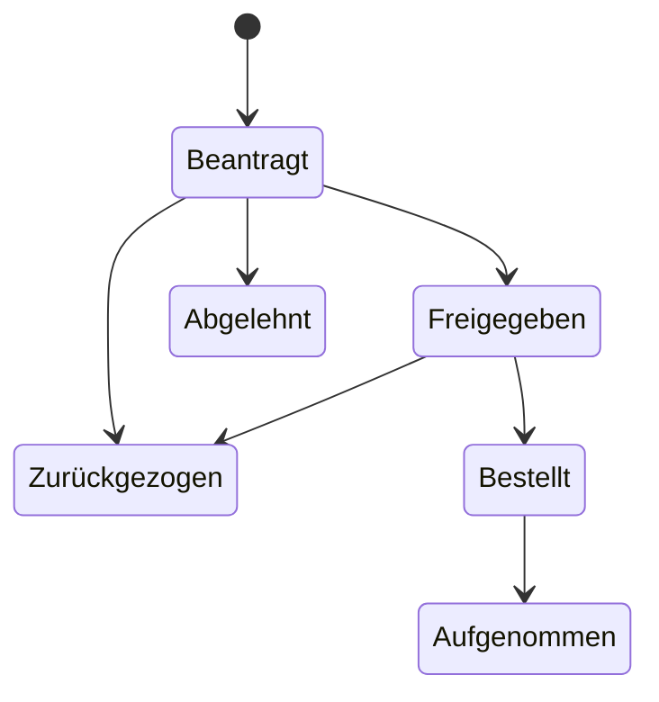

import { Aside, Steps } from '@astrojs/starlight/components';

Unter **Inventar › Beschaffung** führen Sie Beschaffungsanträge vom Antrag bis zur Aufnahme ins Inventar: was beschafft werden soll, für welche Abteilung und welchen Standort, zu welchem Preis, und wie die Geschäftsleitung entschieden hat. Ein Antrag lässt sich zur Unterschrift drucken, als PDF speichern oder als vorbereitete E-Mail verschicken. Nach der Freigabe verknüpfen Sie ihn mit den Assets und dem Verbrauchsmaterial, die er gebracht hat.

Die Beschaffung gehört zur Community-Edition.

## Voraussetzungen

- Eine Rolle mit Schreibrecht für die Beschaffung: **Administrator**, **Informationssicherheit** oder **Bearbeitung**. Alle anderen Rollen sehen die Anträge nur (siehe [Rechte](#rechte)).
- Für die Druckvorlage mit Briefkopf: ein [Logo der Organisation](#logo-der-organisation-für-die-druckvorlage).
- Für das unterschriebene Exemplar: ein eingerichteter Speicher für Dokumente.

## Antrag anlegen

<Steps>

1. Öffnen Sie **Inventar › Beschaffung** und wählen Sie **Antrag anlegen**.

2. Tragen Sie unter **Abteilung und Standort** die **Abteilung**, den **Standort**, den **Antragsteller** und das **Datum des Antrags** ein. Der Antragsteller ist mit Ihrem Namen vorbelegt.

3. Beschreiben Sie unter **Worum es geht** den **Betreff**, etwa „Ausstattung für die Kabelbeschriftung“, und die **Begründung**: warum die Beschaffung nötig ist und was sonst für die Entscheidung zählt.

4. Legen Sie unter **Positionen** jede Position an. Mit **Position hinzufügen** kommt eine weitere dazu, mit **Entfernen** fällt eine weg. Je Position:
   - **Bezeichnung** und **Art** (**Gerät oder Asset**, **Verbrauchsmaterial**, **Dienstleistung** oder **Sonstiges**);
   - **Artikelnummer** und **Artikelbeschreibung**;
   - **Anzahl** und **Einzelpreis**.

   Den **Gesamtpreis** je Position und für den ganzen Antrag rechnet die Seite schon beim Tippen.

5. Wählen Sie unter **Kosten** den **Lieferant**, tragen Sie das **Angebot** ein (Nummer oder Bezeichnung) und legen Sie unter **Preis** fest, ob die Beträge **brutto** oder **netto** gelten. Das gilt für alle Positionen.

6. Wählen Sie **Antrag anlegen**.

</Steps>

Ein Antrag hat 1 bis 100 Positionen; die Anzahl liegt je Position zwischen 1 und 100 000, der Gesamtpreis bei höchstens 1 Milliarde Euro. Fehlt ein Lieferant in der Auswahl, legen Sie ihn dort direkt an, sofern Sie Lieferanten anlegen dürfen.

### Nummern

Jeder Antrag bekommt eine laufende Nummer in Ihrer Organisation. Eine Nummer wird nie ein zweites Mal vergeben, auch nicht nach dem Löschen eines Antrags, weil ein unterschriebenes Papier sie nennen kann. Die Suche findet Anträge über Betreff, Abteilung und Antragsteller sowie über Bezeichnung und Artikelnummer ihrer Positionen; der Filter **Status** grenzt die Liste ein.

## Status und erlaubte Wechsel

| Status | Bedeutung |
|---|---|
| **Beantragt** | Der Antrag wartet auf die Entscheidung. |
| **Freigegeben** | Die Geschäftsleitung hat zugestimmt. |
| **Abgelehnt** | Die Geschäftsleitung hat abgelehnt; der Grund steht am Antrag. |
| **Bestellt** | Die Bestellung ist aufgegeben. |
| **Im Inventar aufgenommen** | Geliefert und ins Inventar übernommen. |
| **Zurückgezogen** | Der Antrag wird nicht weiter verfolgt. |

Die Schritte stehen auf der Seite des Antrags unter **Stand**: **Freigabe erfassen**, **Ablehnung erfassen**, **Antrag zurückziehen**, **Als bestellt markieren** und **Als aufgenommen markieren**. Freigabe, Ablehnung, Bestellung und Aufnahme tragen ihr Datum. Andere Wechsel nimmt der Server nicht an.

Je Status gibt es außerdem genau einen Schritt zurück, damit sich ein Versehen beheben lässt, etwa **Freigabe zurücknehmen**, **Bestellung zurücknehmen** oder **Wieder öffnen** für einen zurückgezogenen Antrag.

**Löschen** lässt sich ein Antrag nur, solange nichts bestellt ist: als **Beantragt**, **Abgelehnt** oder **Zurückgezogen**. Im Audit-Log bleibt er vermerkt.

## Freigabe auf Papier

Viele Geschäftsleitungen unterschreiben lieber auf Papier. Dafür gibt es die Druckvorlage.

<Steps>

1. Öffnen Sie den Antrag und wählen Sie **Drucken**. Die Vorlage zeigt im Kopf das Logo Ihrer Organisation, Abteilung und Standort, die Beschreibung, die Kostenaufstellung und einen Kasten **Genehmigung** mit ja oder nein, Ablehnungsgrund, **Ort, Datum** und **Unterschrift der Geschäftsleitung**.

2. Drucken Sie den Antrag oder wählen Sie im Druckdialog „Als PDF speichern“, und legen Sie ihn der Geschäftsleitung vor.

3. Scannen Sie das unterschriebene Exemplar und wählen Sie am Antrag unter **Unterschriebenes Exemplar** die Schaltfläche **Unterschriebenes Exemplar hochladen**. Die Datei wird als Dokument der Art **Nachweis** abgelegt und mit dem Antrag verknüpft; die Seite des Dokuments nennt den Antrag als Verwendung.

4. Erfassen Sie die Entscheidung, wie sie auf dem Papier steht: **Freigabe erfassen** mit dem **Datum der Freigabe** oder **Ablehnung erfassen** mit Datum und **Ablehnungsgrund**.

</Steps>

Ist die Entscheidung schon erfasst, ist sie auf der Druckvorlage angekreuzt. Mit **Exemplar ersetzen** tauschen Sie die Datei aus, mit **Verknüpfung lösen** trennen Sie sie vom Antrag. Wird das Dokument gelöscht, verliert der Antrag die Verknüpfung mit einem Eintrag im Audit-Log.

## Freigabe in der App

Unterschreibt die Geschäftsleitung nicht auf Papier, erfasst eine Person mit Schreibrecht die Entscheidung direkt mit **Freigabe erfassen** oder **Ablehnung erfassen**. Eine Ablehnung braucht immer einen Grund; ein Grund wird nur zusammen mit einer Ablehnung angenommen.

<Aside type="caution" title="Ein Vermerk, keine Berechtigungsprüfung">
Der Status **Freigegeben** hält die Entscheidung der Geschäftsleitung fest. Er ist keine technische Freigabe mit vier Augen: Wer Anträge schreiben darf, kann ihn setzen, auch für einen eigenen Antrag. Maßgeblich ist die Entscheidung der Geschäftsleitung, etwa die Unterschrift auf dem Papier. Jeder Statuswechsel steht mit Person und Zeitpunkt im Audit-Log.
</Aside>

## Änderungen an einem freigegebenen Antrag

Die Freigabe gilt für den Inhalt, den die Geschäftsleitung gesehen hat.

- **Freigegeben:** Ändern Sie Bezeichnung, Art, Anzahl, Beschreibung, Lieferant, Angebot, Preis oder die Positionen, geht der Antrag zurück auf **Beantragt** und braucht eine neue Freigabe. Die Verknüpfung zum unterschriebenen Exemplar wird dabei gelöst, weil es den alten Stand freigab.
- **Bestellt, Im Inventar aufgenommen, Abgelehnt oder Zurückgezogen:** Inhalt und Preis ändern sich nicht mehr. **Abteilung**, **Standort** und **Antragsteller** können Sie weiter ändern.

Bearbeiten zwei Personen denselben Antrag gleichzeitig, nimmt der Server nur die erste Änderung an; die zweite erhält die Meldung „Der Antrag wurde inzwischen geändert. Bitte laden Sie die Seite neu.“

## Als PDF und per E-Mail

Auf der Seite des Antrags stehen neben **Drucken** zwei weitere Wege. Beide erzeugen das PDF im Browser, gestaltet wie die Druckvorlage mit Logo, Positionen und Kasten **Genehmigung**. Die Daten verlassen Ihr Gerät dafür nicht, und der Server versendet nichts.

- **Als PDF** speichert den Antrag als PDF-Datei, etwa `Beschaffungsantrag-<nummer>.pdf`.
- **Per E-Mail senden** speichert eine Mail-Datei (`.eml`) mit Betreff, Zusammenfassung, Link zum Antrag und dem PDF als Anhang. Die Datei ist als ungesendet gekennzeichnet: Öffnen Sie sie, zeigt Outlook sie als Entwurf, und Sie tragen nur noch den Empfänger ein.
- **ohne Anhang** öffnet Ihr Mailprogramm mit Betreff, Zusammenfassung und Link, aber ohne PDF. Das ist der Weg für Mailprogramme, die Mail-Dateien nicht als Entwurf öffnen; das PDF hängen Sie dann selbst an.

## Mit dem Inventar verknüpfen

Ab der Freigabe zeigt der Antrag die Karte **Im Inventar**: was er gebracht hat.

<Steps>

1. Wählen Sie **Asset anlegen**. Der Dialog für ein neues Asset beginnt mit Bezeichnung, Standort und Lieferant des Antrags; das neue Asset wird gleich mit dem Antrag verknüpft.

2. Oder wählen Sie **Vorhandenes zuordnen**, die **Art** (**Asset** oder **Verbrauchsmaterial**), suchen Sie nach dem Namen und wählen Sie bei einem Treffer **Zuordnen**.

3. Wenn alles geliefert ist, wählen Sie **Als aufgenommen markieren** mit dem **Datum der Aufnahme**.

</Steps>

Ein Antrag nennt höchstens 1 000 Assets und Artikel, jeden einmal. Verknüpfen ändert das Asset nicht. **Entfernen** löst eine Verknüpfung; wird ein verknüpftes Asset oder ein Artikel gelöscht, verschwindet die Verknüpfung mit einem Eintrag im Audit-Log des Antrags.

## Karte „Beschaffung“ auf der Übersicht

Die **Übersicht** zeigt eine Karte **Beschaffung** mit den Anträgen, über die noch nicht entschieden ist. Dazu kommt drei Tage lang jeder Antrag, dessen Status sich geändert hat (freigegeben, abgelehnt, bestellt, aufgenommen, zurückgezogen); danach verschwindet er dort von selbst. Die Karte zeigt höchstens acht Anträge, die zuletzt geänderten zuerst, und führt mit **Zur Beschaffung** zur ganzen Liste.

Maßgeblich ist der letzte Statuswechsel, nicht die letzte Bearbeitung: Eine Änderung an Abteilung oder Standort bringt einen entschiedenen Antrag nicht zurück auf die Karte.

## Rechte

| Rolle | Beschaffungsanträge |
|---|---|
| Administrator, Informationssicherheit, Bearbeitung | ansehen, anlegen, ändern, Stand erfassen, löschen, verknüpfen |
| Datenschutz, Prüfung, Lesend | ansehen, drucken, als PDF oder Mail-Datei speichern |

Das unterschriebene Exemplar sehen nur Personen, deren Vertraulichkeitsstufe das Dokument erlaubt; andere sehen den Hinweis „Ein Dokument über Ihrer Vertraulichkeitsstufe“. Mit [Rechten je Standort](/pro/standortrechte/) (ab Pro) braucht ein Antrag mit Standort Schreibrecht an diesem Standort, ein Umzug an beiden; eine an Standorte gebundene Person schreibt keinen Antrag ohne Standort.

Im Audit-Log stehen Anlegen, Ändern, Statuswechsel und Löschen mit Nummer, Status und den Namen geänderter Felder, dazu Zahl der Positionen, Gesamtmenge und Gesamtpreis. Freitexte wie Bezeichnung, Beschreibung, Antragsteller, Angebot und Ablehnungsgrund erscheinen dort nur als „geändert“, weil sie Personen nennen können.

## Logo der Organisation für die Druckvorlage

Das Logo erscheint im Kopf der Druckvorlage, im PDF und im Übergabeprotokoll der Asset-Ausgaben.

<Steps>

1. Öffnen Sie **Einstellungen › Organisation**. Das Logo legt nur die Administration fest.

2. Wählen Sie unter **Logo** die Schaltfläche **Logo hochladen** und eine Datei.

3. Prüfen Sie die Vorschau. Mit **Logo ersetzen** tauschen Sie es aus, mit **Logo entfernen** löschen Sie es.

</Steps>

Erlaubt sind **PNG** und **JPEG** mit höchstens **512 KB** und **4096 × 4096 Pixeln**; am besten quer und mit transparentem oder weißem Hintergrund. Das Format wird am Inhalt der Datei erkannt, nicht an Name oder Endung. SVG und andere Formate werden aus Sicherheitsgründen abgelehnt, weil sie ausführbaren Inhalt tragen können. Der Server wandelt das Bild nicht um. Jede Änderung steht mit Typ, Größe und Maßen im Audit-Log.

## Ergebnis prüfen

- Der Antrag steht unter **Inventar › Beschaffung** mit Nummer, **Abteilung / Standort** und **Status**.
- Nach **Freigabe erfassen** zeigt die Seite **Freigegeben am** und die Karte **Im Inventar**.
- Die Karte **Beschaffung** auf der Übersicht zeigt offene Anträge und frische Entscheidungen.

## Fehlerbehebung

- **„Dieser Schritt geht vom aktuellen Status aus nicht.“** Der Wechsel ist im Ablauf nicht vorgesehen, etwa von **Beantragt** direkt zu **Bestellt**. Erfassen Sie zuerst die Freigabe.
- **„Ein bestellter Antrag lässt sich nicht löschen.“** Ziehen Sie ihn stattdessen zurück oder nehmen Sie die Bestellung zurück.
- **„Verknüpfen geht erst nach der Freigabe.“** Assets und Verbrauchsmaterial lassen sich erst einem freigegebenen Antrag zuordnen.
- **Zeichen erscheinen im PDF als „?“:** Das PDF nutzt die Standardschriften, die westeuropäische Zeichen kennen. Andere Zeichen ersetzt es durch „?“; die Datei bleibt lesbar. Die Druckvorlage über **Drucken** zeigt alle Zeichen.
- **Outlook öffnet die Mail-Datei nicht als Entwurf:** Nutzen Sie **ohne Anhang** und hängen Sie die Datei aus **Als PDF** selbst an.
- **Das Logo wird abgelehnt:** Prüfen Sie Format, Größe und Maße. Eine beschädigte oder abgeschnittene Datei nimmt der Server nicht an.
