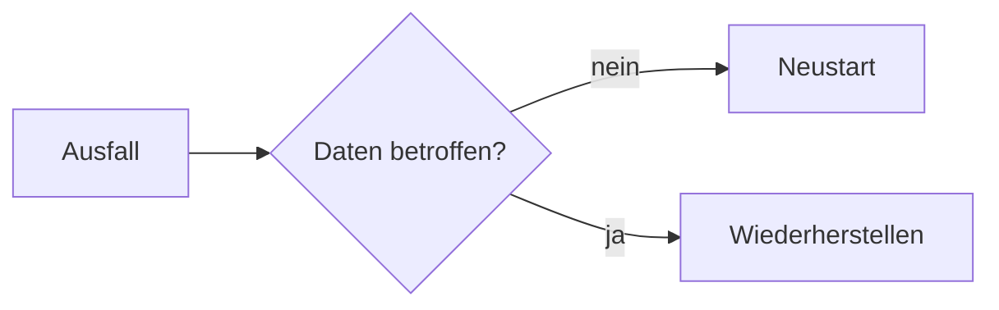

import { Aside, Steps } from '@astrojs/starlight/components';

Zu jedem Asset gehört der Reiter **Dokumentation**. Dort schreiben Sie Anleitungen, Runbooks und Wiederherstellungspläne in Markdown, mit Diagrammen und einer Vorschau neben dem Text. Jedes Speichern legt eine neue Version an.

## Eine Dokumentation anlegen

<Steps>

1. Öffnen Sie das Asset und wählen Sie den Reiter **Dokumentation**.
2. Klicken Sie auf **Neue Dokumentation**, geben Sie einen Titel ein und wählen Sie eine Vorlage und die Vertraulichkeit.
3. Klicken Sie auf **Schreiben**. Links steht der Text, rechts die Vorschau.
4. Klicken Sie auf **Speichern**. Erst dann wird die Dokumentation angelegt.

</Steps>

### Vorlagen

| Vorlage | Inhalt |
|---|---|
| Installation | Zweck, Voraussetzungen, Schritte, Konfiguration, Prüfung, Änderungen |
| Runbook | Überblick mit Diagramm, Ansprechpartner, Abhängigkeiten, Routineaufgaben, Störungen, Eskalation |
| Notfallwiederherstellung | RTO und RPO, Ablauf als Diagramm, Sicherungen, Wiederherstellung, Prüfung, letzter Test |
| Wartung und Updates | Wartungsfenster, Vorbereitung, Vorgehen, Rückfallplan, Protokoll |
| Außerbetriebnahme | Anlass, Daten, Zugänge und Verträge, Entsorgung |

Die Vorlagen gibt es auf Deutsch und Englisch, passend zur Sprache der Oberfläche.

## Schreiben

Die Werkzeugleiste setzt Überschriften, Fettdruck, Listen, Code, Links und Diagramme. Sie können auch direkt Markdown schreiben:

````markdown
## Neustart

1. Dienst stoppen: `systemctl stop app`
2. **Prüfen**, ob alle Verbindungen beendet sind
- [ ] Sicherung vorhanden

| Dienst | Port |
|---|--:|
| Web | 443 |


````

Mit **Markdown-Datei laden** übernehmen Sie eine vorhandene `.md`-Datei in den Editor. Sie wird vorher auf Größe, Kodierung und offene Codeblöcke geprüft.

<Aside type="note" title="Kein HTML">
HTML ist in einer Dokumentation nicht erlaubt. Spitze Klammern vor Buchstaben, etwa `<VirtualHost>`, schreiben Sie in `Code` oder in einen Codeblock. Links führen nur zu `https:` und `mailto:`, Bilder aus dem Netz werden nicht geladen.
</Aside>

## Versionen

Über **Versionen** sehen Sie jede gespeicherte Fassung mit Datum. Eine ältere Version öffnen Sie zum Lesen; mit **Als neue Fassung übernehmen** wird sie zur Grundlage einer neuen Version. Nichts wird überschrieben.

## Rechte und Vertraulichkeit

Eine Dokumentation ist ein Dokument der Art **Dokumentation**. Es gelten dieselben Regeln wie für Dateien: Verschlüsselung, Vertraulichkeit, Standortrechte, Aufbewahrung und Verlauf. Schreiben dürfen die Rollen Administrator, Informationssicherheit und Bearbeitung; wer das Asset sehen darf, liest die Dokumentation bis zu der Vertraulichkeit, die seine Rolle erlaubt. Jedes Lesen steht im Aktivitätsprotokoll.

## Diagramme

Diagramme schreiben Sie in einem Codeblock `mermaid` (Flussdiagramme, Abläufe, Zustände und mehr). Gezeichnet werden sie in einem abgeschotteten Rahmen ohne Zugriff auf Ihre Sitzung. Lässt sich ein Diagramm nicht zeichnen, erscheint sein Quelltext.
