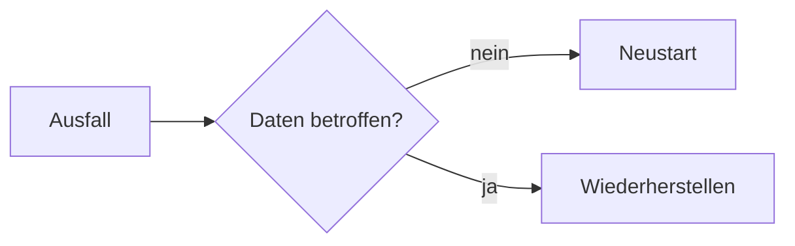

import { Aside, Steps } from '@astrojs/starlight/components';

Zu jedem Asset und jedem Standort (Gebäude, Etage, Raum) gehört der Reiter **Dokumentation**. Dort schreiben Sie Anleitungen, Runbooks und Wiederherstellungspläne in Markdown, mit Diagrammen und einer Vorschau neben dem Text. Jedes Speichern legt eine neue Version an.

## Eine Dokumentation anlegen

<Steps>

1. Öffnen Sie das Asset und wählen Sie den Reiter **Dokumentation**.
2. Klicken Sie auf **Neue Dokumentation**, geben Sie einen Titel ein und wählen Sie eine Vorlage und die Vertraulichkeit.
3. Klicken Sie auf **Schreiben**. Links steht der Text, rechts die Vorschau.
4. Klicken Sie auf **Speichern**. Erst dann wird die Dokumentation angelegt.

</Steps>

### Vorlagen

| Vorlage | Inhalt |
|---|---|
| Installation | Zweck, Voraussetzungen, Schritte, Konfiguration, Prüfung, Änderungen |
| Runbook | Überblick mit Diagramm, Ansprechpartner, Abhängigkeiten, Routineaufgaben, Störungen, Eskalation |
| Notfallwiederherstellung | RTO und RPO, Ablauf als Diagramm, Sicherungen, Wiederherstellung, Prüfung, letzter Test |
| Wartung und Updates | Wartungsfenster, Vorbereitung, Vorgehen, Rückfallplan, Protokoll |
| Außerbetriebnahme | Anlass, Daten, Zugänge und Verträge, Entsorgung |

Für Standorte gibt es eigene Vorlagen:

| Vorlage | Inhalt |
|---|---|
| Standortbeschreibung | Adresse und Zugang, Ansprechpersonen, Räume, Netz und Anbindung mit Diagramm |
| Netz und Subnetze | Adressbereich und Reserve, Tabelle der VLANs mit Subnetz, Gateway, DHCP-Bereich und Zone, feste Adressen, Zonen und erlaubte Übergänge mit Diagramm, Dienste wie DNS und NTP, Änderungen; orientiert am Baustein NET.1.1 |
| Serverraum oder Technikraum | Zutritt, Brandschutz, Klima, Strom und USV, Überwachung, Verkabelung, Prüfungen; orientiert an den Bausteinen INF.2 und INF.5 des IT-Grundschutz-Kompendiums |
| Notfallplan des Standorts | Notrufnummern, Sammelplatz und Räumung, Ausfall von Strom, Netz oder Klima, Wiederanlauf |

Dateien wie Grundrisse, Fotos oder Prüfberichte laden Sie am Standort unter **Dokumente** hoch.

Die Vorlagen gibt es auf Deutsch und Englisch, passend zur Sprache der Oberfläche.

## Schreiben

Die Werkzeugleiste setzt Überschriften, Fettdruck, Listen, Code, Links und Diagramme. Sie können auch direkt Markdown schreiben:

````markdown
## Neustart

1. Dienst stoppen: `systemctl stop app`
2. **Prüfen**, ob alle Verbindungen beendet sind
- [ ] Sicherung vorhanden

| Dienst | Port |
|---|--:|
| Web | 443 |


````

Mit **Markdown-Datei laden** übernehmen Sie eine vorhandene `.md`-Datei in den Editor. Sie wird vorher auf Größe, Kodierung und offene Codeblöcke geprüft.

<Aside type="note" title="Kein HTML">
HTML ist in einer Dokumentation nicht erlaubt, damit die Datei auch in anderen Markdown-Anzeigen kein Skript ausführt. Spitze Klammern vor Buchstaben, etwa in Konfigurationsbeispielen wie `VirtualHost`, gehören in einen Codeblock, der am Zeilenanfang mit drei Backticks beginnt und mit genau denselben drei Backticks endet; in einem Code-Abschnitt innerhalb einer Zeile oder in einem eingerückten Block nimmt der Server sie nicht an. Links führen nur zu `https:`, `http:`, `mailto:` und Pfaden, Bilder aus dem Netz werden nicht geladen.
</Aside>

## Versionen

Über **Versionen** sehen Sie jede gespeicherte Fassung mit Datum. Eine ältere Version öffnen Sie zum Lesen; mit **Als neue Fassung übernehmen** wird sie zur Grundlage einer neuen Version. Nichts wird überschrieben.

## Rechte und Vertraulichkeit

Eine Dokumentation ist ein Dokument der Art **Dokumentation**. Es gelten dieselben Regeln wie für Dateien: Verschlüsselung, Vertraulichkeit, Standortrechte, Aufbewahrung und Verlauf. Schreiben dürfen die Rollen Administrator, Informationssicherheit und Bearbeitung; wer das Asset sehen darf, liest die Dokumentation bis zu der Vertraulichkeit, die seine Rolle erlaubt. Jedes Lesen steht im Aktivitätsprotokoll.

## Als Nachweis verwenden

Viele Dokumentationen belegen Anforderungen des IT-Grundschutzes, etwa zur Dokumentation von Servern, zur Datensicherung oder zum Wiederanlauf.

**In jeder Edition** verknüpfen Sie eine Dokumentation wie jedes andere Dokument als Nachweis: im Grundschutz-Check unter **Nachweise** mit **Nachweis hinzufügen** und **Vorhandenes Dokument verknüpfen**. Höchstens 20 Nachweise gelten je Anforderung.

**Mit dem [ISMS-Add-on](/pro/isms/)** schlägt die Hilfe unter einer Anforderung bei **Umsetzung prüfen** die passenden Dokumentationen vor, in einem zugeklappten Abschnitt **Dokumentation der Assets als Nachweis**:

- Er nennt die Dokumentationen der Assets, für die die Anforderung gilt, je mit Titel, Assets und letzter Änderung. In der Edition 2023 sind das die Assets in Betrieb, für die das Zielobjekt steht (ein einzelnes Asset oder eine Kategorie mit ihren Unterkategorien); der Informationsverbund und Standorte haben keine Vorschläge. In Grundschutz++ sind es die Assets in Betrieb der Kategorien, für die die Anforderung im Informationsverbund gilt.
- **Lesen** öffnet die Dokumentation im Reiter **Dokumentation** am Asset. **Als Nachweis verknüpfen** hängt sie an die Anforderung; eine schon verknüpfte ist als **Als Nachweis verknüpft** gekennzeichnet.
- Die Vorschläge laden erst, wenn Sie den Abschnitt öffnen. Gezeigt werden höchstens 50 Dokumentationen.
- Sie sehen nur Dokumentationen bis zu Ihrer Vertraulichkeitsstufe und nur mit dem Recht, Grundschutz, Inventar und Dokumente zu lesen.

Ob eine Dokumentation die Anforderung belegt, entscheidet eine Person; verknüpft wird nie von selbst. Eine verknüpfte Dokumentation ist ein Nachweis wie jedes Dokument: Sie erscheint unter den Nachweisen des ISMS mit Wiedervorlage, eine neue Fassung ist dort als „neue Fassung ungeprüft“ markiert, und die Seite des Dokuments zeigt, wofür es als Nachweis dient. Ohne Lizenz des Add-ons entfallen die Vorschläge; vorhandene Verknüpfungen bleiben.

## Diagramme

Diagramme schreiben Sie in einem Codeblock `mermaid` (Flussdiagramme, Abläufe, Zustände und mehr). Gezeichnet werden sie in einem abgeschotteten Rahmen ohne Zugriff auf Ihre Sitzung. Lässt sich ein Diagramm nicht zeichnen, erscheint sein Quelltext.
