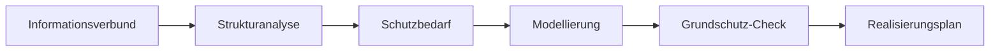

import { Aside, Steps } from '@astrojs/starlight/components';

SentryAssets führt Sie Schritt für Schritt durch den IT-Grundschutz des BSI, auch ohne Informationssicherheitsbeauftragten im Haus. Der IT-Grundschutz ist eine Sammlung von Anforderungen, mit der Sie prüfen, ob Ihre IT ausreichend geschützt ist, und festhalten, was noch fehlt. Grundlage ist Ihr Inventar: **Das Inventar ist die Strukturanalyse.** Assets, Standorte und Beziehungen müssen Sie nicht ein zweites Mal erfassen.

Diese Anleitung ist für Einsteiger geschrieben. Sie folgt genau den Schritten, die die Oberfläche in der Karte **So gehen Sie vor** anzeigt, und erklärt jeden Begriff, sobald er auftaucht. Der IT-Grundschutz gehört zur Community-Edition; Ergänzungen ab Pro stehen unter [Was zu Pro gehört](#was-zu-pro-gehört).

<Aside type="caution" title="Unterstützung, keine Prüfung">
SentryAssets hilft beim Vorgehen, ersetzt aber keine Prüfung. Ob eine Anforderung erfüllt ist, entscheiden Sie; ein Audit oder eine Zertifizierung bleibt Aufgabe einer Prüferin oder eines Prüfers.
</Aside>

## Voraussetzungen

- Eine Rolle mit Zugriff auf den Grundschutz: **Administrator**, **Informationssicherheit**, **Bearbeitung**, **Datenschutz** oder **Prüfung (nur lesend)**. Die Rolle **Lesend** sieht den Grundschutz nicht, weil offene Anforderungen zeigen, wo eine Organisation verwundbar ist. Was welche Rolle darf, steht unter [Rechte](#rechte).
- Ein gepflegtes Inventar: Assets mit **Kategorie** und **Standort**. Die Kategorie ist wichtig, denn aus ihr leitet SentryAssets die Vorschläge ab.
- Die Datei des BSI für Ihre Variante. Sie laden sie selbst herunter; SentryAssets verbindet sich dafür nicht mit dem Internet.

## Variante wählen

Das BSI bietet den IT-Grundschutz derzeit in zwei Fassungen an, und SentryAssets unterstützt beide. Öffnen Sie **Grundschutz**. Die Seite zeigt unter **Welche Variante passt zu Ihnen?** beide Fassungen nebeneinander. Oben wählen Sie unter **Variante** zwischen **Grundschutz++** und **Edition 2023**; die Wahl steht in der Adresse der Seite, ein Lesezeichen öffnet also immer dieselbe Variante.

**Kurz gesagt:**

- **Edition 2023**, wenn Sie in den nächsten Jahren ein Zertifikat (ISO 27001 auf Basis von IT-Grundschutz) anstreben oder schon eine Grundschutz-Dokumentation haben. Das Vorgehen ist ausgereift und gut beschrieben; Sie arbeiten mit **Bausteinen**, etwa „Windows Server“ oder „Serverraum“, die Sie Ihren Geräten und Räumen zuordnen.
- **Grundschutz++**, wenn Sie ohne bisherige Dokumentation anfangen und sich gleich auf die künftige Fassung des BSI ausrichten möchten. Sie wählen nur, welche Arten von Dingen Sie haben, und bekommen daraus ein **Anforderungspaket**; Bausteine zuordnen müssen Sie nicht.

Im Zweifel beginnen Sie mit der Variante, zu der Ihre Prüferin, Ihr Kunde oder Ihre Branche rät.

| | Grundschutz++ | Edition 2023 |
|---|---|---|
| Aufbau | 20 Praktiken, etwa Governance, Konfiguration oder Detektion; Anforderungen beziehen sich direkt auf Zielobjekt-Kategorien | Bausteine in Schichten (ISMS, Anwendungen, IT-Systeme, Netze, Infrastruktur), bei der Modellierung den Zielobjekten zugeordnet |
| Umfang | rund 1.000 Anforderungen mit MUSS, SOLLTE oder KANN, je mit Sicherheitsniveau (normal oder erhöht) und Aufwand von 0 bis 5 | über 100 Bausteine mit Basis-, Standard- und Anforderungen bei erhöhtem Schutzbedarf |
| Format | maschinenlesbar (OSCAL), laufend aktualisiert | Kompendium als PDF und XML in jährlichen Editionen |
| Methodik | Methodik-Leitfaden vom April 2026, noch in der Erprobung | BSI-Standards 200-1 bis 200-3 mit Basis-, Standard- und Kern-Absicherung |
| Zertifizierung | voraussichtlich ab 2027 | ISO 27001 auf Basis von IT-Grundschutz, voraussichtlich noch bis Ende 2028 |
| Geeignet für | Einstieg ohne bisherige Grundschutz-Dokumentation, Ausrichtung auf die künftige Fassung | wer jetzt ein Zertifikat anstrebt oder eine bestehende Dokumentation weiterführt |

Stand Oktober 2026 nach Angaben des BSI; Termine zu Zertifizierung und Übergang können sich ändern.

## Der Weg nach BSI-Standard 200-2

Die Begriffe in Kürze:

- **Informationsverbund:** der Teil Ihrer Organisation, den Sie absichern, mit allen Prozessen, Anwendungen, IT-Systemen, Räumen und Personen (BSI-Standard 200-2, Kap. 3.3). Für den Einstieg ist das meist die ganze Organisation.
- **Strukturanalyse:** festhalten, woraus der Informationsverbund besteht. Die Teile heißen **Zielobjekte**.
- **Schutzbedarf:** wie schlimm ein Ausfall, ein Datenleck oder eine Verfälschung wäre: normal, hoch oder sehr hoch.
- **Modellierung:** jedem Zielobjekt die passenden Bausteine zuordnen (nur Edition 2023).
- **Grundschutz-Check:** je Anforderung festhalten, ob sie umgesetzt ist.
- **Realisierungsplan:** was noch fehlt, mit Verantwortlichen und Terminen. Ihre Antworten im Grundschutz-Check sind seine Grundlage; den vollständigen Plan ergänzt das [ISMS-Add-on](/pro/isms/).

Die Seite **Grundschutz** zeigt in der Karte **So gehen Sie vor**, wo Sie stehen: Jeder Schritt nennt seinen Stand, etwa „noch nicht erledigt“, und bietet die passende Schaltfläche an. Unter **Aufgaben** erinnert SentryAssets an fällige Schritte, für die Rollen, die sie gehen dürfen.

## Edition 2023 Schritt für Schritt

Wählen Sie unter **Variante** die **Edition 2023**. Die Karte **So gehen Sie vor** führt in fünf Schritten vom Informationsverbund bis zum Grundschutz-Check.

### Kompendium einlesen

Bevor es losgeht, braucht SentryAssets das IT-Grundschutz-Kompendium des BSI. Einlesen dürfen **Administrator** und **Informationssicherheit**.

<Steps>

1. Wählen Sie in der Karte **IT-Grundschutz-Kompendium** den Link **Seite des BSI zum Kompendium öffnen**.

2. Laden Sie dort die „XML-Version des IT-Grundschutz-Kompendiums“ herunter.

3. Wählen Sie **Kompendium einlesen** und die heruntergeladene Datei.

</Steps>

SentryAssets prüft die Datei vollständig, bevor es sie speichert, und meldet danach „Kompendium eingelesen“. Die Karte zeigt **Titel**, **Edition**, die Zahl der **Bausteine** und **Anforderungen** sowie die **Prüfsumme (SHA-256)**. Mit **Bausteine ansehen** blättern Sie im Kompendium, gefiltert nach **Schicht** und **Zielobjekttyp**. Erscheint eine neue Fassung, lesen Sie sie mit **Neue Fassung einlesen** ein.

### Informationsverbund festlegen

Der erste Schritt heißt **Was wollen Sie schützen?**

<Steps>

1. Wählen Sie **Informationsverbund festlegen**.

2. Tragen Sie einen **Name** ein, an dem Sie den Verbund erkennen. Mit **Vorschlag einsetzen** übernehmen Sie einen fertigen Text für den **Geltungsbereich**, der die ganze Organisation umfasst.

3. Wählen Sie die **Vorgehensweise**. Sie legt fest, wie gründlich Sie vorgehen:
   - **Basis-Absicherung**: nur die Basis-Anforderungen. Empfohlen für den Einstieg; Sie sichern schnell das Wichtigste ab und bauen später aus.
   - **Standard-Absicherung**: der vollständige Weg, mit dem ein ISO-27001-Zertifikat auf Basis von IT-Grundschutz möglich ist.
   - **Kern-Absicherung**: wie die Standard-Absicherung, aber zuerst nur für die besonders wichtigen Abläufe und Werte.

4. Wählen Sie **Speichern**.

</Steps>

Den Verbund ändern Sie später mit **Verbund bearbeiten**.

### Zielobjekte erfassen

Der zweite Schritt heißt **Woraus besteht er?** Hier erfassen Sie die Zielobjekte, also das, wofür die Bausteine gelten. Der Informationsverbund selbst ist schon das erste Zielobjekt. Dazu kommen:

- **Kategorie**: eine Gruppe gleichartiger Assets, etwa alle Clients. Das ist der einfachste Weg, viele Geräte auf einmal abzudecken.
- **Asset**: ein einzelnes, wichtiges System, etwa der Dateiserver.
- **Standort**: ein Gebäude, Raum oder Rechenzentrum aus Ihrem Standortbaum.

<Steps>

1. Wählen Sie in der Karte **Zielobjekte** die Schaltfläche **Zielobjekt hinzufügen**.

2. Wählen Sie die **Art des Zielobjekts**: **Kategorie**, **Asset** oder **Standort**.

3. Suchen Sie das Objekt, etwa über **Kategorie suchen**, und wählen Sie es unter **Treffer**.

4. Wählen Sie **„…“ hinzufügen**.

</Steps>

Die Liste zeigt je Zielobjekt die Zahl der Assets in Betrieb, der Bausteine und den Stand des Checks („Check: … erledigt“). Ein Zielobjekt entfernen Sie auf seiner Seite mit **Zielobjekt entfernen**; das Objekt im Inventar bleibt erhalten.

### Schutzbedarf festlegen

Der dritte Schritt heißt **Wie schutzbedürftig ist es?** Überlegen Sie je Zielobjekt, wie schlimm ein Ausfall, ein Datenleck oder eine Verfälschung wäre. **Normal reicht für das meiste.** Ohne Angabe gilt normal.

<Steps>

1. Öffnen Sie das Zielobjekt aus der Liste.

2. Wählen Sie unter **Schutzbedarf** einen Wert: **normaler Schutzbedarf**, **hoher Schutzbedarf** oder **sehr hoher Schutzbedarf**.

</Steps>

Bei hohem oder sehr hohem Schutzbedarf gehören auch die Anforderungen für erhöhten Schutzbedarf zum Check, sofern Sie nicht die Basis-Absicherung gewählt haben.

Unabhängig davon pflegen Sie den Schutzbedarf einzelner Assets je Schutzziel (Vertraulichkeit, Integrität, Verfügbarkeit) im Inventar, auch für viele auf einmal mit **Schutzbedarf setzen**. Für Standorte gilt das Maximumprinzip: je Schutzziel der höchste Wert der Assets dort (BSI-Standard 200-2, Kap. 8.2).

### Bausteine zuordnen

Der vierte Schritt heißt **Welche Bausteine passen?** Ein Baustein des BSI beschreibt die Anforderungen an eine bestimmte Art von Objekt, etwa einen Server oder einen Serverraum. Diese Zuordnung heißt Modellierung.

<Steps>

1. Öffnen Sie ein Zielobjekt. Unter **Vorschläge** schlägt SentryAssets passende Bausteine vor, jeweils mit Begründung, etwa „Passt zur Kategorie des Inventars“, „Betriebssystem … laut Agent“ oder „Standortart: …“.

2. Übernehmen Sie jeden passenden Vorschlag einzeln mit **… übernehmen**.

3. Fehlt ein Baustein, suchen Sie ihn unter **Weiteren Baustein zuordnen** über **Bausteine durchsuchen**. Jeder Baustein des Kompendiums lässt sich zuordnen, auch ohne Vorschlag.

4. Prüfen Sie die Liste **Modellierte Bausteine**. Einen falschen Baustein nehmen Sie mit **Entfernen** wieder heraus.

</Steps>

Ein Hauptsitz oder eine Niederlassung ohne erfasstes Gebäude bekommt INF.1 wie ein Gebäude. Ein einzelnes Asset ohne Kategorie bekommt keine Vorschläge, denn das Betriebssystem allein unterscheidet keinen Server von einem Client; die Seite führt mit **Kategorie am Asset wählen** direkt dorthin. Mit [Pro](/pro/modellierung/) übernehmen Sie alle Vorschläge auf einmal.

### Grundschutz-Check der Zielobjekte

Der fünfte Schritt heißt **Was ist schon umgesetzt?** Die Anforderungen der modellierten Bausteine bilden den Check: in der Basis-Absicherung die Basis-Anforderungen, sonst auch die Standard-Anforderungen und bei hohem Schutzbedarf die für erhöhten Schutzbedarf.

<Steps>

1. Wählen Sie in der Karte **So gehen Sie vor** die Schaltfläche **Check fortsetzen**. Sie führt zum ersten Zielobjekt mit offenen Anforderungen. Alternativ öffnen Sie ein Zielobjekt und wählen in der Karte **Grundschutz-Check** die Schaltfläche **Check öffnen**.

2. Wählen Sie unter **Baustein** den Baustein, den Sie bearbeiten wollen. Mit **Offen** blenden Sie aus, was schon beantwortet ist.

3. Lesen Sie bei Bedarf den **Text der Anforderung**. Ein Kennzeichen zeigt die Stufe: **Basis** (zuerst umsetzen), **Standard** oder **Erhöhter Schutzbedarf**.

4. Beantworten Sie die Anforderung, wie unter [Der Grundschutz-Check: so antworten Sie](#der-grundschutz-check-so-antworten-sie) beschrieben.

5. Wechseln Sie mit **Zum Zielobjekt** zurück und gehen Sie das nächste Zielobjekt durch.

</Steps>

## Grundschutz++ Schritt für Schritt

Wählen Sie unter **Variante** **Grundschutz++**. Die Karte **So gehen Sie vor** führt in vier Schritten vom BSI-Katalog zu Ihrem Stand.

### Katalog einlesen

Einlesen dürfen **Administrator** und **Informationssicherheit**.

<Steps>

1. Wählen Sie in der Karte **Katalog Grundschutz++** den Link **Datei beim BSI öffnen**. Gemeint ist die Datei `Grundschutz++-resolved_catalog.json` in der Stand-der-Technik-Bibliothek des BSI.

2. Speichern Sie die Datei dort über „Download raw file“.

3. Wählen Sie **Katalog einlesen** und die gespeicherte Datei.

</Steps>

SentryAssets prüft die Datei vollständig und meldet „Katalog eingelesen“. Die Karte zeigt **Fassung vom**, **Eingelesen am**, die Zahl der **Anforderungen** und die **Prüfsumme**. Mit **Anforderungen ansehen** schlagen Sie den ganzen Katalog nach, gefiltert nach **Praktik**, **Modalität**, **Sicherheitsniveau** und **Zielobjekt**. Eine neue Fassung lesen Sie mit **Neue Fassung einlesen** ein.

### Informationsverbund und Anforderungspaket

Der erste Schritt heißt **Was wollen Sie schützen?** Aus dem Informationsverbund stellt SentryAssets Ihr **Anforderungspaket** zusammen, also die Anforderungen, die für Sie gelten.

<Steps>

1. Wählen Sie **Informationsverbund festlegen**.

2. Tragen Sie **Name** und **Geltungsbereich** ein oder übernehmen Sie den Text mit **Vorschlag einsetzen**.

3. Entscheiden Sie über zwei Ankreuzfelder. Für den Einstieg empfiehlt die Oberfläche, beide frei zu lassen:
   - **Auch Anforderungen für das erhöhte Sicherheitsniveau einbeziehen** nur, wenn Sie besonders schützenswerte Informationen verarbeiten, etwa Gesundheits-, Personal- oder Finanzdaten in großem Umfang, oder Kunden und Vorschriften es verlangen.
   - **KANN-Anforderungen einbeziehen**: KANN-Anforderungen sind freiwillige Zusatzmaßnahmen. Setzen Sie zuerst die MUSS- und SOLLTE-Anforderungen um.

4. Wählen Sie **Speichern**.

</Steps>

Die Karte **Informationsverbund** zeigt danach **Sicherheitsniveau** und **KANN-Anforderungen**; ändern können Sie beides jederzeit mit **Informationsverbund bearbeiten**.

### Zielobjekte wählen

Der zweite Schritt heißt **Woraus besteht er?** In Grundschutz++ wählen Sie keine einzelnen Geräte, sondern **Zielobjekt-Kategorien**, also Arten von Dingen, etwa IT-Systeme, Anwendungen oder Räume. Nur Anforderungen, die zu diesen Kategorien passen, kommen ins Paket. Ohne gewählte Kategorie enthält das Paket nur die Anforderungen für den ganzen Verbund.

<Steps>

1. Wählen Sie **Zielobjekte wählen**.

2. Unter **Vorschläge aus Inventar und Standorten** nennt SentryAssets Kategorien mit der Zahl passender Assets in Betrieb oder Standorte. Manche sind als „gibt es in jeder Institution“ markiert.

3. Übernehmen Sie jeden passenden Vorschlag mit **… übernehmen**. Er erscheint danach als „gewählt“.

4. Fehlt eine Kategorie, wählen Sie sie unter **Weitere Kategorie** aus und bestätigen mit **Hinzufügen**. Die Auswahl zeigt je Kategorie, wie viele Anforderungen sie mitbringt.

</Steps>

Ihre Assets ordnen Sie dabei nicht einzeln zu: Die Vorschläge stammen aus den Kategorien Ihres Inventars und Ihren Standorten. Pflegen Sie deshalb zuerst die Kategorien im Inventar.

### Parameter festlegen

Der dritte Schritt heißt **Ihre Regeln festlegen**. Manche Anforderungen lassen eine Stelle offen, die Ihre Organisation selbst festlegt: wie oft etwas geschieht, wer zuständig ist oder nach welchem Standard gearbeitet wird.

<Steps>

1. Wählen Sie **Parameter festlegen**. Die Seite **Parameter** zeigt die Parameter der Anforderungen in Ihrem Paket; mit **Offen** sehen Sie nur, was noch fehlt.

2. Lesen Sie je Parameter die kurze Erklärung, etwa bei einer Frist „Wie lange oder bis wann?“, und die **Stelle in der Anforderung**.

3. Tragen Sie Ihren Wert unter **Ihr Wert anstelle von „…“** ein oder wählen Sie einen der **Vorschläge:**.

4. Wählen Sie **Speichern**.

</Steps>

Bleibt ein Feld leer, gilt der Wortlaut des BSI. Ihr Wert steht danach in der Anforderung, im Grundschutz-Check und im Export und bleibt über neue Katalogversionen erhalten. Wählen Sie Werte, die Sie wirklich durchhalten: Ein eingehaltener Jahresrhythmus ist besser als ein versäumter Monatsrhythmus.

### Umsetzung prüfen

Der vierte Schritt heißt **Was ist schon umgesetzt?** Gehen Sie Ihr Paket durch und geben Sie je Anforderung an, ob sie umgesetzt ist.

<Steps>

1. Wählen Sie **Umsetzung prüfen**, in der Karte **So gehen Sie vor** oder in der Karte **Anforderungspaket**. Die Seite **Umsetzung prüfen** zeigt den **Grundschutz-Check**.

2. Wählen Sie unter **Praktik** eine Praktik. Mit **Offen** blenden Sie aus, was schon beantwortet ist; ist alles erledigt, steht dort „Hier ist nichts mehr offen.“

3. Öffnen Sie bei einer Anforderung **Was heißt das? Woran erkennen Sie es?**. Dort steht, was die Modalität bedeutet (MUSS: muss unbedingt erfüllt werden; SOLLTE: normalerweise erfüllen, Abweichungen stichhaltig begründen; KANN: je nach Situation sinnvoll), das **Erwartetes Ergebnis:** und **Als Nachweis eignet sich:**. Der Text enthält dabei schon Ihre Parameterwerte.

4. Beantworten Sie die Anforderung, wie im nächsten Abschnitt beschrieben.

</Steps>

Sie können eine Anforderung auch über **Anforderungen ansehen** öffnen: Die Karte **Umsetzung bei Ihnen** dort zeigt dieselbe Antwort wie unter **Umsetzung prüfen**.

## Der Grundschutz-Check: so antworten Sie

In beiden Varianten beantworten Sie jede Anforderung gleich. Oben auf der Seite erklärt **So bewerten Sie eine Anforderung**, wann welche Antwort richtig ist:

| Antwort | Wann richtig | Was Sie zusätzlich eintragen |
|---|---|---|
| **Ja** | Umgesetzt, und Sie könnten es jemandem zeigen: ein Dokument, eine Einstellung oder ein Ablauf, der tatsächlich so gelebt wird. | nichts; am besten einen Nachweis verknüpfen |
| **Teilweise** | Begonnen oder nur für einen Teil umgesetzt, etwa an einem von zwei Standorten. | **Was fehlt noch? (optional)**, **Verantwortlich**, **Umsetzung bis** |
| **Nein** | Noch nicht umgesetzt. | **Was fehlt noch? (optional)**, **Verantwortlich**, **Umsetzung bis** |
| **Entbehrlich** | Trifft bei Ihnen nicht zu, etwa weil es die betroffene Technik oder den Ablauf nicht gibt. Bei MUSS-Anforderungen ist das selten. | **Warum entbehrlich? (Pflicht)** |

<Steps>

1. Wählen Sie bei der Anforderung **Ja**, **Teilweise**, **Nein** oder **Entbehrlich**. Die Antwort wird sofort gespeichert; die Meldung bietet **Rückgängig** an.

2. Bei **Teilweise** oder **Nein** erscheinen weitere Felder. Notieren Sie unter **Was fehlt noch? (optional)**, was zu tun ist, wählen Sie unter **Verantwortlich** eine Person aus Ihren Verantwortlichen und setzen Sie unter **Umsetzung bis** einen Termin. Wählen Sie **Speichern**.

3. Bei **Entbehrlich** tragen Sie unter **Warum entbehrlich? (Pflicht)** die Begründung ein und wählen **Speichern**. Ohne Begründung wird nichts gespeichert: Entbehrlich gilt erst mit Begründung.

</Steps>

**Im Zweifel „Teilweise“ wählen** und notieren, was fehlt: Das ist ehrlicher als ein „Ja“ und zeigt, was zu tun ist.

**Wann gilt etwas als erfüllt?** Sobald Sie eine Anforderung mit **Ja** bewerten. **Entbehrlich** zählt mit Begründung ebenfalls als erledigt; **Teilweise** und **Nein** zeigen, was noch zu tun ist. Daraus entsteht der Fortschritt.

### Nachweise verknüpfen

Ein Nachweis zeigt, dass eine Anforderung umgesetzt ist: etwa ein Beschluss der Geschäftsführung, ein Protokoll, ein Bericht oder ein Bildschirmfoto einer Einstellung. Die Dateien liegen bei den Dokumenten, im Check sind sie verknüpft.

<Steps>

1. Öffnen Sie bei der Anforderung **Nachweis hinzufügen** (oder die Zahl der Nachweise, wenn schon welche verknüpft sind).

2. Wählen Sie **Neues Dokument hochladen**, um eine Datei abzulegen und gleich zu verknüpfen. Titel und Art sind vorgeschlagen.

3. Oder wählen Sie **Vorhandenes Dokument verknüpfen**, suchen Sie unter **Dokument suchen** und wählen Sie **Verknüpfen**.

</Steps>

Mit **Lösen** nehmen Sie einen Nachweis wieder heraus; das Dokument bleibt erhalten. Bei Grundschutz++ nennt der Bereich zusätzlich, was das BSI als Nachweis vorschlägt. Die Seite eines Dokuments zeigt, wofür es als Nachweis dient.

## Fortschritt und Termine

- Der Check zeigt oben **Bewertet** mit „… von … bewertet“, je Praktik bzw. Baustein ebenso.
- Bei der Edition 2023 zeigt jedes Zielobjekt „… von … Anforderungen umgesetzt oder entbehrlich“; die Karte **So gehen Sie vor** zählt die bewerteten Anforderungen über alle Zielobjekte.
- Bei Grundschutz++ zeigt die Karte **Anforderungspaket** den Stand je Status: offen, umgesetzt, teilweise, nicht umgesetzt, entbehrlich.
- Ein überschrittener Termin ist mit **überfällig** markiert. Fällige und überfällige Termine erscheinen als Aufgaben. Bei Grundschutz++ öffnet die Aufgabe den Check gefiltert nach **Termin überschritten** oder **In 30 Tagen fällig**; **Filter aufheben** zeigt wieder alles. Bei der Edition 2023 führt sie zur Seite **Grundschutz**, wo die Liste der Zielobjekte überschrittene Termine je Zielobjekt nennt.
- Bei Grundschutz++ exportieren Sie das Anforderungspaket mit seinem Umsetzungsstand unter **Umsetzung prüfen** mit **CSV exportieren**.
- Enthält ein neuer Katalog Grundschutz++ eine Anforderung oder einen Parameter nicht mehr, nennt die Seite die betroffenen Einträge; mit **Entfernen** und **Endgültig entfernen** löschen Sie sie. Das lässt sich nicht rückgängig machen, das Audit-Log vermerkt es.

## Rechte

| Rolle | Grundschutz |
|---|---|
| Administrator, Informationssicherheit | alles: Katalog und Kompendium einlesen, Informationsverbund festlegen, Zielobjekte, Parameter, Check beantworten, Nachweise |
| Bearbeitung | sehen und den Check beantworten |
| Datenschutz, Prüfung (nur lesend) | nur sehen |
| Lesend | kein Zugriff |

Beide Varianten verwenden dieselben Rechte. Ab Pro passen Sie Rechte an [eigene Rollen](/pro/rollen-anpassen/) an.

## Hinweise und Grenzen

- Katalog- und Kompendiumsdatei: höchstens 16 MB. Steht ein Reverse-Proxy vor SentryAssets, muss er für diesen Upload mindestens 16 MB erlauben.
- Edition 2023: höchstens 500 Zielobjekte und 200 Bausteine je Zielobjekt. Fassen Sie gleichartige Assets in einer Kategorie zusammen.
- Höchstens 20 Nachweise je Anforderung; fassen Sie Belege am besten in einem Dokument zusammen.
- Parameterwerte: höchstens 500 Zeichen in einer Zeile.

## Beispiel: RECPLAST GmbH

Die RECPLAST GmbH ist das Beispielunternehmen des BSI. In SentryAssets könnte ihr Weg mit der Edition 2023 so aussehen:

1. Informationsverbund „RECPLAST gesamt“ mit dem Hauptsitz und der Fertigung als Standorten, Basis-Absicherung.
2. Die Agents erfassen Server und Clients; der Collector findet Drucker und Switches. Die Kategorien „Server“, „Clients“ und „Netzwerk“ werden zu Zielobjekten.
3. Der Dateiserver erhält Schutzbedarf „hoch“ für Vertraulichkeit, weil dort Konstruktionsdaten liegen; der Standort Hauptsitz übernimmt diesen Wert nach dem Maximumprinzip.
4. SentryAssets schlägt für die Windows-Server die passenden Bausteine vor, für den Serverraum den Baustein für Serverräume.
5. Im Grundschutz-Check hängt der ISB das freigegebene Datensicherungskonzept als Nachweis an.

## Was zu Pro gehört

Die Community-Edition enthält den ganzen geführten Weg. Ab Pro kommen hinzu:

- [Schutzbedarf vererben](/pro/schutzbedarf/) entlang der Abhängigkeiten.
- [Automatische Modellierung](/pro/modellierung/): alle Vorschläge auf einmal übernehmen.
- [Freigaben im Grundschutz-Check](/pro/freigaben/) nach dem Vier-Augen-Prinzip.
- [Prüfregeln](/pro/pruefregeln/), die Anforderungen aus den Daten des Inventars prüfen.
- Das [ISMS-Add-on](/pro/isms/) ergänzt Leitlinie, Risikoanalyse nach BSI-Standard 200-3, Realisierungsplan und die Referenzdokumente A.0 bis A.6.

## Weiterführend

- Der [Hilfe-Assistent](/reference/ki-assistent/) beantwortet Fragen zum Kompendium mit Quellen.
