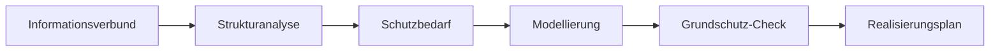

import { Aside, Steps } from '@astrojs/starlight/components';

SentryAssets führt Sie Schritt für Schritt durch den IT-Grundschutz des BSI, auch ohne Informationssicherheitsbeauftragten im Haus. Grundlage ist Ihr Inventar: **Das Inventar ist die Strukturanalyse.** Assets, Standorte und Beziehungen müssen Sie nicht ein zweites Mal erfassen.

<Aside type="caution" title="Unterstützung, keine Prüfung">
SentryAssets hilft beim Vorgehen, ersetzt aber keine Prüfung. Ob eine Anforderung erfüllt ist, entscheiden Sie; ein Audit oder eine Zertifizierung bleibt Aufgabe einer Prüferin oder eines Prüfers.
</Aside>

## Variante wählen

SentryAssets unterstützt beide Varianten des IT-Grundschutzes. Unter **Grundschutz** vergleicht eine Übersicht Aufbau, Umfang, Aufwand, Zertifizierbarkeit und Übergangsfristen.

| | Grundschutz++ | Edition 2023 |
|---|---|---|
| Aufbau | 20 Praktiken, etwa Governance, Konfiguration oder Detektion; Anforderungen beziehen sich direkt auf Zielobjekt-Kategorien | Bausteine in Schichten (ISMS, Anwendungen, IT-Systeme, Netze, Infrastruktur), bei der Modellierung den Zielobjekten zugeordnet |
| Umfang | rund 1.000 Anforderungen mit MUSS, SOLLTE oder KANN, je mit Sicherheitsniveau (normal oder erhöht) und Aufwand von 0 bis 5 | über 100 Bausteine mit Basis-, Standard- und Anforderungen bei erhöhtem Schutzbedarf |
| Format | maschinenlesbar (OSCAL), laufend aktualisiert | Kompendium als PDF und XML in jährlichen Editionen |
| Methodik | Methodik-Leitfaden vom April 2026, noch in der Erprobung | BSI-Standards 200-1 bis 200-3 mit Basis-, Standard- und Kern-Absicherung |
| Zertifizierung | voraussichtlich ab 2027 | ISO 27001 auf Basis von IT-Grundschutz, voraussichtlich noch bis Ende 2028 |
| Geeignet für | Einstieg ohne bisherige Grundschutz-Dokumentation, Ausrichtung auf die künftige Fassung | wer jetzt ein Zertifikat anstrebt oder eine bestehende Dokumentation weiterführt |

Stand Oktober 2026 nach Angaben des BSI; Termine zu Zertifizierung und Übergang können sich ändern.

Beide Kataloge laden Sie selbst beim BSI herunter und importieren sie; SentryAssets prüft die Datei vollständig, bevor es sie speichert.

## Der Weg nach BSI-Standard 200-2

Die Seite **Grundschutz** zeigt, wo Sie stehen, und nennt den einen nächsten Schritt. Unter **Aufgaben** erinnert SentryAssets an diesen Schritt, für die Rollen, die ihn gehen dürfen.

<Steps>

1. **Informationsverbund festlegen.** Der Informationsverbund umfasst alle Prozesse, Anwendungen, IT-Systeme, Räume und Personen, die Sie gemeinsam betrachten (BSI-Standard 200-2, Kap. 3.3). Der Dialog erklärt, was dazugehört, und schlägt Namen und Geltungsbereich vor. Für Grundschutz++ wählen Sie dazu Sicherheitsniveau und Modalität, für die Edition 2023 die Vorgehensweise (Basis-, Standard- oder Kern-Absicherung); zum Einstieg empfiehlt der Dialog die Basis-Absicherung.

2. **Strukturanalyse aus dem Inventar.** Die Zielobjekte stammen aus Ihrem Inventar: der Informationsverbund selbst, Kategorien als Gruppen gleichartiger Assets, einzelne Assets und Standorte. Für Grundschutz++ schlägt SentryAssets die Zielobjekt-Kategorien aus Inventar und Standorten vor.

3. **Schutzbedarf feststellen.** Je Schutzziel (Vertraulichkeit, Integrität, Verfügbarkeit) legen Sie den Schutzbedarf fest: normal, hoch oder sehr hoch. Für Standorte gilt das Maximumprinzip: je Schutzziel der höchste Wert der Assets dort (BSI-Standard 200-2, Kap. 8.2). Mit [Pro](/pro/schutzbedarf/) vererbt SentryAssets den Schutzbedarf entlang der Abhängigkeiten.

4. **Modellieren.** Für die Edition 2023 schlägt SentryAssets Bausteine vor, aus der Kategorie, aus den Betriebssystemen, die die Agents melden, und aus der Art des Standorts, jeweils mit Begründung; Sie übernehmen sie einzeln oder ordnen weitere über die Suche zu. Für Grundschutz++ ergibt sich das Anforderungspaket aus dem Informationsverbund. Mit [Pro](/pro/modellierung/) übernehmen Sie alle Vorschläge auf einmal.

5. **Parameter festlegen** (Grundschutz++). Manche Anforderungen enthalten Parameter, etwa eine Frist. Jeder Parameter sagt, welche Art Wert gefragt ist, mit passenden Vorschlägen; Ihre Werte bleiben über neue Katalogversionen erhalten und erscheinen in den Texten der Anforderungen.

6. **Grundschutz-Check.** Je Anforderung erfassen Sie den Stand: umgesetzt, teilweise, nicht umgesetzt oder **entbehrlich** (nur mit Begründung), dazu Verantwortliche, Termin und Notiz. Eine Legende sagt, wann welche Antwort richtig ist; jede Anforderung von Grundschutz++ erklärt ihren Text mit Ihren Werten, das erwartete Ergebnis und passende Nachweise.

7. **Nachweise verknüpfen.** Dokumente, die eine Umsetzung belegen, etwa den Beschluss der Geschäftsführung, hängen Sie an den Stand einer Anforderung, vorhandene oder direkt hochgeladene. Die Seite eines Dokuments zeigt, wofür es als Nachweis dient.

</Steps>

## Fortschritt und Termine

- Die **Übersicht** zeigt den Fortschritt je Praktik bzw. Baustein und Zielobjekt.
- Fällige und überfällige Termine erscheinen als Aufgaben.
- Das Anforderungspaket mit seinem Umsetzungsstand exportieren Sie als CSV.
- Einträge, deren Anforderung oder Parameter ein neuerer Katalog nicht mehr enthält, lassen sich entfernen.

## Beispiel: RECPLAST GmbH

Die RECPLAST GmbH ist das Beispielunternehmen des BSI. In SentryAssets könnte ihr Weg so aussehen:

1. Informationsverbund „RECPLAST gesamt“ mit dem Hauptsitz und der Fertigung als Standorten, Basis-Absicherung.
2. Die Agents erfassen Server und Clients; der Collector findet Drucker und Switches. Die Kategorien „Server“, „Clients“ und „Netzwerk“ werden zu Zielobjekten.
3. Der Dateiserver erhält Schutzbedarf „hoch“ für Vertraulichkeit, weil dort Konstruktionsdaten liegen; der Standort Hauptsitz übernimmt diesen Wert nach dem Maximumprinzip.
4. SentryAssets schlägt für die Windows-Server die passenden Bausteine vor, für den Serverraum den Baustein für Serverräume.
5. Im Grundschutz-Check hängt der ISB das freigegebene Datensicherungskonzept als Nachweis an.

## Weiterführend

- Das [ISMS-Add-on](/pro/isms/) ergänzt Leitlinie, Risikoanalyse nach BSI-Standard 200-3, Realisierungsplan und die Referenzdokumente A.0 bis A.6.
- [Freigaben im Grundschutz-Check](/pro/freigaben/) nach dem Vier-Augen-Prinzip (Pro).
- Der [KI-Assistent](/reference/ki-assistent/) beantwortet Fragen zum Kompendium mit Quellen.
