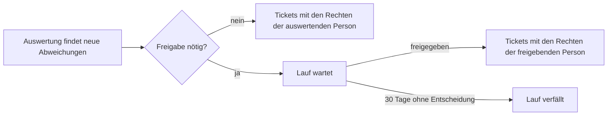

import { Badge } from '@astrojs/starlight/components';

<Badge text="Pro" variant="note" /> Diese Funktion gilt ab der Edition Pro.

Ein Workflow macht neue Abweichungen von [Prüfregeln](/pro/pruefregeln/) ohne Handarbeit zu [Tickets](/pro/tickets/).

## Ein Workflow legt fest

- auf welche Regeln er reagiert (oder alle);
- den Mindestschweregrad;
- das Ticketsystem und die Sprache der Tickets;
- wie viele Tickets ein Lauf erstellen darf (höchstens 20);
- ob er sofort läuft oder auf eine Freigabe wartet.

## Ablauf

- Ein Workflow startet, sobald eine Auswertung durch Administration oder Informationssicherheit neue Abweichungen festhält.
- Jedes Ticket wird geprüft, als würde es von Hand erstellt.
- Eine Auswertung erstellt höchstens 50 Tickets; Abweichungen über eine Grenze hinaus werden als übersprungen gezählt.
- Ein fehlschlagender Workflow hält die Auswertung nie an.
