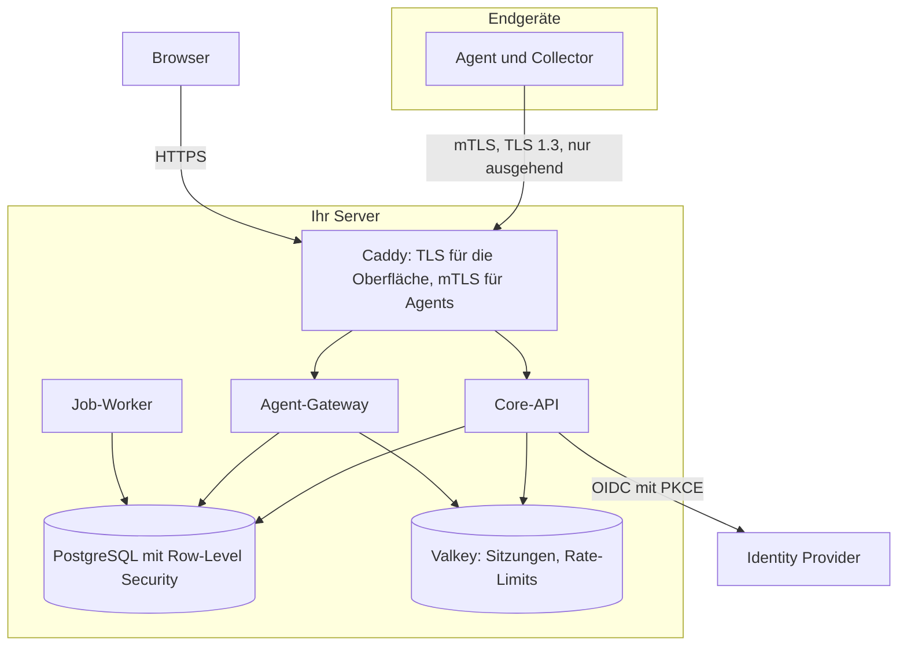

SentryAssets ist ein **modularer Monolith**: eine Backend-Anwendung mit klar getrennten Fachmodulen, ein Job-Worker, eine Weboberfläche und ein Agent für Endgeräte.

## Dienste

| Dienst | Aufgabe |
|---|---|
| `caddy` | TLS-Terminierung, Auslieferung der Oberfläche, mTLS-Prüfung der Agents, Agent-Downloads |
| `api` | Fachlogik, REST-API für Oberfläche und Integrationen, Anmeldung als Backend-for-Frontend |
| `gateway` | Annahme der Agent-Daten, Enrollment, Ausstellen und Erneuern der Zertifikate; eigener Prozess mit eigenen Rechten |
| `worker` | Hintergrundaufgaben: Abgleiche, Benachrichtigungen, Prüfung der Audit-Kette, Sperrlisten, Konnektoren |
| `postgres` | Datenhaltung; jede Fachtabelle mit Mandanten-ID und Row-Level Security |
| `valkey` | Sitzungen, Anmeldeabläufe, Rate-Limits |
| `migrate` | Datenbankschema anlegen und aktualisieren, läuft einmal und endet |
| `cli`, `backup` | Werkzeuge für Einrichtung, PKI, Administratorkonten, Audit-Prüfung und Sicherung |
| `clamav` | optionaler Virenscanner ohne Netz, über einen Socket |

## Grundregeln

- **API und Gateway sind getrennte Prozesse** mit getrennten Datenbankrollen und ohne gemeinsames Netz. Ein kompromittierter Agent-Endpunkt erreicht weder die Sitzungen der Oberfläche noch die API.
- **Mandantentrennung** per Row-Level Security in PostgreSQL und zusätzlich in jedem Service-Aufruf. Die Datenbankrolle der Anwendung ist nicht Eigentümerin der Tabellen.
- **Getrennte Datenbankrollen** für Migration, API, Gateway, Worker und Sicherung.
- **Jede schreibende Aktion** erzeugt einen Eintrag im Audit-Log mit Hash-Kette.
- **Erweiterungen** (Pro, Enterprise, ISMS-Add-on) werden über eine Plugin-Schnittstelle geladen; der Kern enthält keine Verzweigungen nach Edition.

## Netze

Die Compose-Datei trennt die Container in eigene Netze mit festen Adressbereichen innerhalb von `172.30.248.0/21`:

| Netz | Wer | Nach außen |
|---|---|---|
| `edge` | Caddy | ja: veröffentlichte Ports und ACME |
| `ui-proxy` | Caddy und API | nein |
| `agent-proxy` | Caddy und Gateway | nein |
| `data` | API, Worker, Migration, Werkzeuge mit PostgreSQL und Valkey | nein |
| `gateway-data` | Gateway mit PostgreSQL und Valkey | nein |
| `egress` | API und Worker, für Identity Provider und Konnektoren | ja |

Das Gateway hat keinen Weg nach außen. Alle Container laufen ohne Root-Rechte, mit schreibgeschütztem Dateisystem, ohne Capabilities und mit Ressourcenlimits.

## Agent-Verbindung

- Caddy prüft das Client-Zertifikat (mTLS mit TLS 1.3) und reicht es in einem Header weiter, den es immer überschreibt. Das Gateway prüft das Zertifikat zusätzlich selbst: Kette, Gültigkeit und Sperrliste.
- Identität und Mandant eines Agents stammen **ausschließlich** aus dem geprüften Zertifikat, nie aus den Nutzdaten.
- Jede Nachricht trägt Zeitpunkt und Folgenummer; wiederholte oder zu alte Nachrichten werden verworfen (Replay-Schutz). Größen, Entpackgrößen und Raten sind begrenzt.

Mehr zur Sicherheit unter [Sicherheit](/reference/sicherheit/), zum Betrieb mit mehreren Instanzen unter [Hochverfügbarkeit](/pro/hochverfuegbarkeit/).
